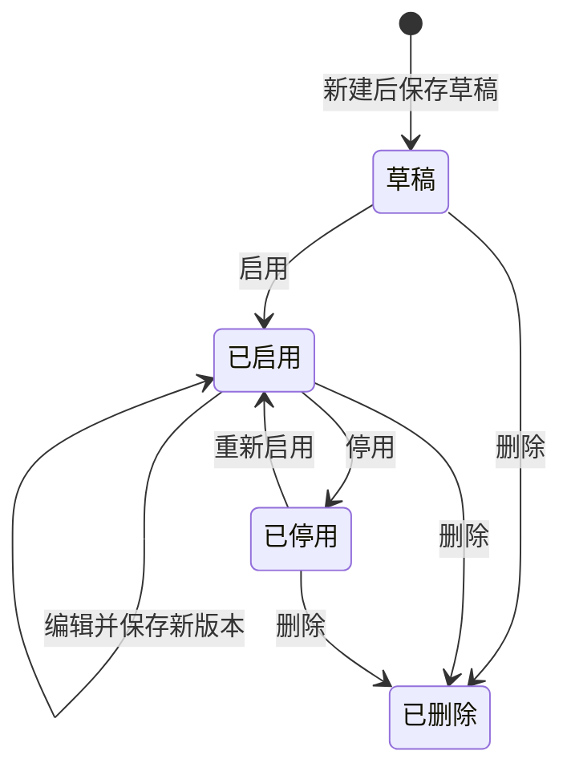

# Skills 配置需求说明

> 本文件为 2026-06-01 修订版 PRD。第 1 版主要描述目标与字段；第 2 版对齐早期 Skills 原型；本版基于当前 `prototype/` 最新前端 demo，重点同步 P2 三列开发编辑器、Skills 管理页、用户对话页的实际交互与边界。

## 1. 背景与定位

当前智能体平台分为运营平台与智能体开发平台：运营平台负责智能体列表、详情、发布、审核与运行数据；智能体开发平台负责模型、提示词、变量、工具、MCP、工作流、知识库与 Skills 等运行能力配置。

**Skills** 是新增的轻量能力资源，用于沉淀可复用的任务方法、表达规范、推理步骤和输出结构。它不是工具调用，也不是知识库，而是注入到智能体运行上下文中的“方法型指令资源”。

本次需求只聚焦 **Skills 配置扩展**：

- Skills 资源的创建、导入、编辑、启停、删除与可见范围维护发生在智能体开发平台的 Skills 管理页。
- 智能体的长期 Skills 绑定发生在开发平台编排编辑器的「智能体核心配置 / 能力配置 / Skills」行。
- 用户对话页支持选择当前会话临时 Skills，不回写智能体长期配置。
- 运营平台智能体详情页仅提供「前往开发平台」入口，不再承载 Skills 长期绑定配置区。

## 2. 核心术语

| 术语 | 含义 | 发生位置 |
|---|---|---|
| Skill | 可复用的任务方法、输出规范、审查框架或专业模板 | 全平台 |
| 新建 Skill | 从零创建一个新的 Skill 资源 | 开发平台 Skills 管理页 |
| 导入 Skill | 从 `SKILL.md` 文件或 Skill 包解析并预填创建表单 | 开发平台 Skills 管理页 |
| 管理 Skill | 编辑、启用、停用、删除、查看详情与使用统计 | 开发平台 Skills 管理页 |
| 长期绑定 Skill | 将 Skill 保存到某个智能体配置中，后续运行默认注入 | 开发平台编排编辑器 |
| 临时使用 Skill | 只在当前会话中启用 Skill，不写回智能体配置 | 用户对话页 |
| 引用失效 | 历史绑定的 Skill 已被删除，运行时不再注入 | 开发平台编排编辑器 |

## 3. 角色与权限

| 角色 | 能力 |
|---|---|
| 开发平台管理员 / 资源维护者 | 新建、导入、编辑、启用、停用、删除和维护 Skill 可见范围 |
| 智能体创建者 / 配置人员 | 在开发平台编排编辑器中为智能体绑定有权限的已启用 Skills |
| 普通用户 | 在用户对话页选择有权限的已启用 Skills，临时辅助当前会话 |
| 运营人员 / 审核人员 | 在运营平台查看智能体状态、发布与运行数据；通过入口跳转开发平台配置 |

**权限规则**

- 用户只能看到当前账号权限范围内的 Skills。
- 只有「已启用」且「有权限」的 Skills 可被新绑定或临时添加。
- 「草稿」「已停用」「无权限」Skills 不出现在长期绑定弹窗和临时选择弹窗中。
- 历史已绑定但被停用或删除的 Skill 仍在智能体配置中保留提示，便于排查：
  - 已停用：展示为风险 chip，标注「已停用」，运行时不注入。
  - 已删除：展示为「引用失效 / 已删除」，运行时不注入，用户可手动移除。

## 4. 功能范围

### 4.1 智能体开发平台 · Skills 管理

入口位于开发平台「组件中心 / Skills」，对应原型 `10-skills-management.html`。该页面用于维护可被智能体引用的 Skills 资源。

#### 4.1.1 列表

列表以表格展示，不使用卡片目录。

| 字段 | 说明 |
|---|---|
| 名称 | Skill 名称 + 当前版本号副行 |
| 描述 | 面向用户的一句话能力说明 |
| 分类 | 输出规范 / 审查方法 / 办公效率 / 知识辅助 / 专业模板 |
| 状态 | 草稿 / 已启用 / 已停用 |
| 可见范围 | 全公司 / 指定组织 / 指定用户等 |
| 更新时间 | 最近编辑或状态变更时间 |
| 操作 | 编辑 + 更多操作菜单 |

工具栏能力：

- 搜索：按名称、描述、场景匹配。
- 分类筛选：全部分类、输出规范、审查方法、办公效率、知识辅助、专业模板。
- 状态筛选：全部状态、已启用、草稿、已停用。
- 标题栏操作：`导入 Skill`、`新建 Skill`。
- 分页：默认 10 条 / 页，支持 10 / 20 / 50 切换。
- 空状态：展示「暂无匹配 Skill」，并提供「新建 Skill」CTA。

行交互：

- 点击行空白区域打开右侧详情抽屉。
- 点击「编辑」打开新建 / 编辑表单 modal。
- 点击「更多」展开行内菜单，按状态展示启用、停用、重新启用、删除等操作。
- 点击页面其他区域或按 `Esc` 关闭已展开菜单 / modal / 抽屉。

#### 4.1.2 新建 Skill

点击「新建 Skill」打开居中表单 modal。

表单字段：

| 字段 | 规则 |
|---|---|
| 名称 | 必填，例如「报告结构化」 |
| 分类 | 必填，下拉选择 |
| 描述 | 面向用户的一句话能力说明 |
| 适用场景 | 短文本，描述适用任务或关键词 |
| 可见范围 | 全公司 / 指定组织 / 指定用户 |
| 技能内容 | 给模型执行的具体方法、步骤或推理框架 |
| 输出要求 | 输出结构或格式要求，例如「结论 / 依据 / 下一步」 |

底部按钮：

- `取消`：关闭 modal，不保存。
- `保存草稿`：保存为 `draft`，列表新增一行并高亮。
- `启用`：保存为 `enabled`，启用后可被智能体长期绑定或用户临时选择。

校验与反馈：

- 名称为空时提示「请填写名称」，不关闭 modal。
- 启用时若「技能内容」为空，提示「建议填写技能内容后再启用」，但不阻断保存，允许先创建占位 Skill 后补全。
- 保存成功后使用 toast 反馈，不再弹出详情态二次确认。

#### 4.1.3 编辑 Skill 与版本号

编辑入口来自列表行「编辑」或详情抽屉「编辑」。

编辑规则：

- 草稿 Skill：可「保存草稿」或「启用」。
- 已启用 Skill：表单按钮文案为「保存」，隐藏「保存草稿」；保存时仅当内容有改动才发布新版本。
- 已停用 Skill：可「保存草稿」或「重新启用」。

版本机制：

- 新建 Skill 初始版本为 `v0.1.0`。
- 编辑已启用 Skill 且内容有变更后保存，自动补丁位 +1，例如 `v1.2.0` → `v1.2.1`。
- 编辑已启用 Skill 但内容无变更时，不创建新版本，toast 提示「内容无变更，未创建新版本」。
- 草稿保存不变更版本号。

#### 4.1.4 导入 Skill

点击「导入 Skill」打开导入 modal。

当前原型能力：

- 支持选择 `.md` / `.markdown` 文件。
- 支持将文件拖入 dropzone。
- 识别后展示「已识别」预览卡片，并启用「下一步」。
- 点击「下一步」后关闭导入 modal，打开新建 Skill 表单，并用解析结果预填名称、分类、描述、技能内容、输出要求等字段。
- 表单顶部展示提示「以下内容由 SKILL.md 解析，请确认后保存。」

需求目标能力：

- 支持上传完整 Skill 文件夹，识别根目录 `SKILL.md`，并展示文件夹名与文件数量。
- 支持解析 GitHub 常见 `SKILL.md` frontmatter，例如 `name`、`description`、`instructions`。
- `references/`、`assets/` 等附属目录的真实入库、附件管理、沙箱执行不在一期范围。

> 当前 demo 中「文件夹导入」为交互目标说明，真实文件夹解析需要后端或浏览器目录能力补齐；一期可以前端 mock 完成流程演示。

#### 4.1.5 详情抽屉

点击列表行空白区域打开右侧 480px 详情抽屉。

抽屉内容：

- 头部：Skill 名称、版本号、更新时间。
- 状态 / 分类 / 可见范围 / 版本 chip。
- 已启用 Skill 展示使用统计：绑定智能体数、近 7 日会话使用次数。
- 已停用 Skill 展示风险提示：「该 Skill 已停用，配置页和对话页将无法选择，仅历史绑定保留。」
- 字段段落：描述、适用场景、技能内容、输出要求。
- 底部按钮按状态动态展示：
  - 草稿：编辑、启用、删除。
  - 已启用：编辑、停用、删除。
  - 已停用：编辑、重新启用、删除。

#### 4.1.6 状态生命周期



说明：

- 不再设置「已废弃」状态；软隔离使用「停用」，彻底清理使用「删除」。
- 删除为真删除语义：列表中不再出现，但历史绑定保留失效提示。
- 删除前必须二次确认。

#### 4.1.7 删除确认

任何删除入口均先弹出确认 modal：

- 标题：「确认删除」
- 副文案：「删除后不可恢复；已绑定该 Skill 的智能体将显示引用失效。」
- 按钮：`取消` / `删除`

确认删除后：

- 列表立即刷新。
- 如果详情抽屉正在展示该 Skill，则自动关闭抽屉。
- 已绑定该 Skill 的智能体在下次渲染绑定 chip 时展示「引用失效 / 已删除」。

### 4.2 智能体开发平台 · 编排编辑器：长期绑定

入口位于开发平台编排编辑器 `06-dev-editor.html` 的「智能体核心配置 / 能力配置 / Skills」行。该页面是智能体长期能力配置的主入口，运营平台详情页通过「前往开发平台」跳转到这里。

#### 4.2.1 页面结构

开发编辑器采用三列布局：

| 区域 | 说明 |
|---|---|
| 智能体画像 | 编辑固定 Prompt / 角色画像 |
| 智能体核心配置 | 模型配置、输入/输出配置、能力配置、知识库配置、多智能体协作 |
| 预览与调试 | 基于当前配置发送测试消息 |

Skills 位于「能力配置」中，与工具调用、工作流调用、MCP 服务同构：

```text
工具调用                         [icon-jump]
工作流调用                  [+] [icon-jump]
MCP 服务                         [icon-jump]
Skills                      [+] [icon-jump]
  ↳ 已绑定 Skill chips
```

交互说明：

- `+`：打开「选择 Skills」弹窗，保存后成为当前智能体长期绑定配置。
- `icon-jump`：跳转到开发平台 Skills 管理页，继承当前 agent 上下文。
- 已绑定 Skills 展示在行下方 chip 区域。
- chip 支持移除；移除后立即更新当前智能体绑定集合。
- 空状态展示「暂未选择 Skill，点击 + 添加」。

#### 4.2.2 选择 Skills 弹窗

点击 Skills 行内 `+` 后打开居中弹窗。

弹窗结构：

- 顶部：标题「选择 Skills」，副文案「从智能体开发平台已启用且已授权的 Skills 中选择，保存后成为智能体长期配置。」
- 工具栏：搜索框 + 分类筛选 + 「仅展示可新增选择的 Skills」提示。
- 主体：左侧多选列表 + 右侧详情面板。
- 底部：`去开发平台管理` 链接 + `已选 N 个` 计数 + `取消` / `确认选择`。

列表规则：

- 仅展示 `status=enabled` 且当前账号 `authorized=true` 的 Skills。
- 支持按名称、分类、场景、描述搜索。
- 支持按分类筛选。
- 已选项展示选中态。

详情面板展示：

- Skill 名称。
- 描述。
- 状态、分类、版本。
- 场景与输出要求预览。

确认后：

- 写入当前智能体的 `boundSkillIds`。
- 关闭弹窗。
- 刷新 chip 区域。
- toast 提示「已更新智能体 Skills 绑定」。

#### 4.2.3 绑定 chip 风险态

| Skill 当前状态 | chip 表现 |
|---|---|
| 已启用且有权限 | 默认 chip，可移除 |
| 已停用 | 风险 chip，展示「已停用」，可移除 |
| 已删除 | 失效 chip，展示「引用失效 / 已删除」，可移除 |

风险态或失效态 Skill 不参与运行注入，但保留在配置 UI 中，便于用户理解历史配置为什么不再生效。

#### 4.2.4 运营平台详情页关系

运营平台智能体详情页 `05-agent-detail.html` 不再展示 Skills 配置行。它的职责是：

- 展示基本信息、运行数据、版本与发布。
- 提供「前往开发平台」入口，让配置人员进入 `06-dev-editor.html` 完成提示词、模型、工具、工作流、MCP、知识库与 Skills 绑定。
- 第三方智能体不允许进入开发平台编辑，页面展示第三方来源提示。

因此，PRD 与验收中不再要求运营平台详情页提供 Skills 绑定弹窗。

#### 4.2.5 预览与调试边界

当前 `06-dev-editor.html` 的「预览与调试」区支持发送测试消息、清空对话和记录测试使用，但没有独立的「预览临时 Skills」选择入口。

本期规则：

- 预览与调试使用当前智能体长期配置中的 Skills。
- 不在预览区单独增加临时 Skills 选择条。
- 如后续需要“仅本次预览生效”的临时 Skills，可作为二期优化加入，但不得在当前 PRD 中写成已实现能力。

### 4.3 用户对话页：临时使用 Skill

入口位于用户对话页 `09-user-chat.html`。该能力面向普通用户，用于在当前会话内临时启用 Skills。

#### 4.3.1 输入区入口

对话输入区结构：

- 模型选择。
- 智能体选择。
- 临时 Skills chip 区域，默认隐藏。
- 输入框左侧 `+` 按钮，title 为「选择临时 Skill（当前会话）」。
- 发送按钮。

#### 4.3.2 临时 Skill 选择弹窗

点击输入框左侧 `+` 后打开 560px 轻量弹窗。

弹窗结构：

- 标题：「选择临时 Skill」
- 副文案：「仅对当前会话生效，不回写智能体配置。」
- 工具栏：搜索框 + 「已授权 · 已启用」提示。
- 主体：可选 Skills 多选列表，每行展示名称与描述。
- 底部：`已选 N 个` + `取消` / `完成`。

选择完成后：

- 输入框上方展示已选 Skill chips。
- chip 可点击 `×` 移除。
- 未选择任何 Skill 时，chip 区域隐藏。
- toast 提示「已更新当前会话 Skills」或「当前会话未选择 Skill」。

#### 4.3.3 行为约束

- 临时 Skill 只影响当前会话。
- 不回写智能体长期配置。
- 不触发智能体发布或审核。
- 新会话不继承上一会话临时 Skill。
- 用户发送消息后，回复区标注「本轮使用 Skill：xxx」；未使用时标注「无」。

## 5. 数据与运行逻辑

### 5.1 核心对象 `skill`

| 字段 | 说明 |
|---|---|
| `skill_id` | Skill 唯一标识 |
| `name` | 名称 |
| `description` / `prompt` | 面向用户的能力说明 |
| `category` | 输出规范 / 审查方法 / 办公效率 / 知识辅助 / 专业模板 |
| `scenario_tags` / `scenario` | 适用场景 |
| `skill_content` / `content` | 给模型执行的技能内容 |
| `output_spec` / `output` | 输出要求 |
| `status` | `draft` / `enabled` / `disabled` |
| `version` | 语义化版本号，例如 `v1.2.0` |
| `visibility_scope` / `scope` | 可见范围 |
| `authorized` | 当前账号是否有权限 |
| `created_by` | 创建人 |
| `updated_at` | 更新时间 |

字段说明：

- 一期不独立维护 `examples` 字段；示例可并入「技能内容」或后续二期拆出。
- `status` 不包含 `deprecated`；停用与删除分别承担软隔离和硬清理语义。
- 已删除 Skill 通过 deleted id 集合维护，列表不可见，历史绑定按失效引用渲染。

### 5.2 智能体绑定

当前原型中，智能体绑定 Skills 存储在 agent state 的 `boundSkillIds` 中；真实系统可落为 `agent_skill_bindings`。

建议数据结构：

| 字段 | 说明 |
|---|---|
| `agent_id` | 智能体 ID |
| `skill_id` | Skill ID |
| `skill_version` | 绑定时版本 |
| `enabled` | 是否启用 |
| `bind_source` | 固定为 `config` |
| `created_by` | 绑定人 |
| `created_at` | 绑定时间 |

原型约束：

- Demo 智能体 `agt_demo_001` 默认绑定 `sk_report`、`sk_risk`。
- `boundSkillIds` 为空且未设置 `skillsCleared=true` 时，系统自动恢复默认绑定。
- 用户主动清空全部 Skills 后，写入 `skillsCleared=true`，后续展示空状态，不自动恢复默认。
- 已删除 Skill 不从绑定记录中硬删，UI 渲染为「引用失效 / 已删除」，用户可手动移除。

### 5.3 会话临时使用

建议真实系统记录 `session_skill_usages`：

| 字段 | 说明 |
|---|---|
| `session_id` | 会话 ID |
| `agent_id` | 智能体 ID |
| `skill_id` | Skill ID |
| `skill_version` | 使用时版本 |
| `enabled_at` | 添加时间 |
| `disabled_at` | 移除时间 |
| `user_id` | 操作用户 |

当前原型临时 Skills 仅保存在页面运行态，不写入长期配置。

### 5.4 运行注入顺序

```text
系统指令 → 智能体画像 / Prompt → 长期绑定 Skills → 当前会话临时 Skills → 用户消息
```

注入规则：

- 草稿、已停用、已删除、无权限 Skill 不参与注入。
- 长期绑定 Skills 来自当前智能体配置。
- 临时 Skills 只在当前会话本轮及后续会话上下文中生效，直到用户移除或会话结束。
- 当 Skill 所需变量缺失时，应提示用户补充或使用已配置默认值；无默认值时不得静默注入。

## 6. 异常与边界

| 场景 | 处理 |
|---|---|
| 管理页无匹配结果 | 展示空状态，并提供「新建 Skill」CTA |
| 名称为空保存 | 提示「请填写名称」，不关闭 modal |
| 启用时技能内容为空 | 温和提示，但允许保存 |
| 草稿 Skill | 只在管理页可见，不出现在长期绑定 / 临时选择列表 |
| 已停用 Skill | 不可新增绑定；历史绑定展示风险 chip，运行时过滤 |
| 已删除 Skill | 不可新增绑定；历史绑定展示引用失效 chip，运行时过滤 |
| 无权限 Skill | 不在选择列表展示；接口层仍需二次校验 |
| 用户清空长期绑定 | 展示空状态，不自动恢复默认 |
| 会话中移除临时 Skill | 后续消息不再注入该 Skill |
| 新会话 | 不继承上一会话临时 Skill |
| 编辑已启用 Skill 无内容变更 | 不创建新版本，提示「内容无变更，未创建新版本」 |
| 编辑已启用 Skill 有内容变更 | 自动补丁位 +1，保存新版本 |
| 运营平台详情页配置 Skills | 不支持；通过「前往开发平台」进入编辑器配置 |
| 第三方智能体 | 开发平台编辑入口禁用，不能配置 Skills |

## 7. 验收标准

### 7.1 开发平台 · Skills 管理页

- [ ] 页面入口为 `10-skills-management.html`，侧边栏「组件中心 / Skills」高亮。
- [ ] 列表以表格展示资源，不使用卡片目录。
- [ ] 工具栏包含搜索、分类筛选、状态筛选。
- [ ] 标题栏包含「导入 Skill」和「新建 Skill」按钮。
- [ ] 支持 10 / 20 / 50 条分页切换。
- [ ] 空结果展示「暂无匹配 Skill」并提供「新建 Skill」CTA。
- [ ] 新建表单包含名称、分类、描述、适用场景、可见范围、技能内容、输出要求。
- [ ] 新建表单支持「保存草稿」和「启用」。
- [ ] 名称为空时提示「请填写名称」且不关闭 modal。
- [ ] 启用时技能内容为空，提示「建议填写技能内容后再启用」。
- [ ] 编辑已启用 Skill 时按钮文案为「保存」，隐藏「保存草稿」。
- [ ] 编辑已启用 Skill 且内容有变更时，版本号补丁位 +1。
- [ ] 编辑已启用 Skill 且内容无变更时，提示「内容无变更，未创建新版本」。
- [ ] 行空白区域打开右侧详情抽屉。
- [ ] 详情抽屉展示描述、适用场景、技能内容、输出要求。
- [ ] 已启用 Skill 详情抽屉展示绑定智能体数和近 7 日会话使用次数。
- [ ] 已停用 Skill 详情抽屉展示风险提示。
- [ ] 更多菜单按状态展示启用 / 停用 / 重新启用 / 删除。
- [ ] 删除必须经过二次确认，确认后列表刷新，详情抽屉自动关闭。
- [ ] 导入 modal 支持选择 `.md` / `.markdown` 文件和拖拽文件，识别后进入预填表单。

### 7.2 开发平台 · 编排编辑器长期绑定

- [ ] 页面入口为 `06-dev-editor.html`。
- [ ] 编辑器为三列布局：智能体画像、智能体核心配置、预览与调试。
- [ ] Skills 位于「智能体核心配置 / 能力配置」下。
- [ ] Skills 行与工具调用 / 工作流调用 / MCP 服务视觉同构。
- [ ] Skills 行内 `+` 打开「选择 Skills」弹窗。
- [ ] Skills 行内跳转图标进入 `10-skills-management.html`。
- [ ] 选择弹窗只展示已启用且有权限的 Skills。
- [ ] 选择弹窗支持搜索、分类筛选、多选、右侧详情预览。
- [ ] 底部展示「去开发平台管理」「已选 N 个」「取消」「确认选择」。
- [ ] 确认后更新 `boundSkillIds` 并刷新绑定 chips。
- [ ] 已绑定 Skill 以 chip 展示，支持 `×` 移除。
- [ ] 空绑定展示「暂未选择 Skill，点击 + 添加」。
- [ ] 已停用历史绑定展示风险 chip。
- [ ] 已删除历史绑定展示「引用失效 / 已删除」并允许移除。
- [ ] 运营平台详情页 `05-agent-detail.html` 不展示 Skills 配置行，只提供「前往开发平台」链路。

### 7.3 用户对话页临时 Skills

- [ ] 页面入口为 `09-user-chat.html`。
- [ ] 输入框左侧有 `+` 按钮，title 为「选择临时 Skill（当前会话）」。
- [ ] 点击 `+` 弹出 560px「选择临时 Skill」弹窗。
- [ ] 弹窗只展示已启用且有权限的 Skills。
- [ ] 弹窗支持搜索和多选。
- [ ] 完成后在输入框上方展示临时 Skill chips。
- [ ] chip 可点击 `×` 移除。
- [ ] 未选择任何 Skill 时 chip 区域隐藏。
- [ ] 临时 Skill 不回写智能体长期配置。
- [ ] 发送消息后，回复中标注「本轮使用 Skill：xxx」；未选择时标注「无」。

### 7.4 运营平台链路

- [ ] `05-agent-detail.html` 包含「前往开发平台」入口。
- [ ] 点击「前往开发平台」进入 `06-dev-editor.html`，继承当前 agent 上下文。
- [ ] 运营平台详情页只展示基本信息、运行数据、版本与发布，不提供 Skills 新建、编辑、绑定入口。
- [ ] 第三方智能体隐藏或禁用开发平台编辑入口，并提示配置由外部服务管理。

### 7.5 跨页一致性

- [ ] 同一份 Skill 数据由统一 catalog 获取，管理页、绑定弹窗、临时选择弹窗状态一致。
- [ ] 在 Skills 管理页停用某 Skill 后，长期绑定弹窗和临时选择弹窗不再展示该 Skill。
- [ ] 在 Skills 管理页删除某 Skill 后，任何已绑定该 Skill 的智能体配置 chip 转为「引用失效 / 已删除」。
- [ ] 清空智能体长期 Skills 后，页面展示空状态，不自动恢复默认。
- [ ] 新会话不继承上一会话临时 Skills。

## 8. 范围外（本期不做）

- 真实解析 `SKILL.md` frontmatter、`references/`、`assets/` 并入库。
- Skill 沙箱执行、插件包上传、外部 API 调用。
- Skill 版本回滚 / 版本对比 UI。
- Skill 权限授权流程 UI；本期只保留可见范围字段与授权过滤结果。
- 多模型差异化 Skill。
- Skill 之间的依赖与组合编排。
- 开发编辑器预览区的“仅本次预览临时 Skills”入口。
- 运营平台详情页内直接创建、编辑或绑定 Skills。

## 9. 本次修订变更记录

| # | 修订点 | 原文 / 旧理解 | 当前版本 |
|---|---|---|---|
| 1 | 长期绑定入口 | 早期 PRD 将长期绑定入口放在运营侧详情 / 配置区 | 开发平台 `06-dev-editor.html` 的「能力配置 / Skills」行负责长期绑定 |
| 2 | 运营平台详情页定位 | 05 页包含配置区与 Skills 行 | 05 页只承载基本信息、运行数据、版本与发布，并提供「前往开发平台」 |
| 3 | 预览临时 Skills | 预览区存在「预览临时 Skills」条 | 当前原型未实现，降级为后续可选优化 |
| 4 | 管理页能力 | 保留早期 Skills 管理描述 | 对齐当前表格、筛选、分页、详情抽屉、导入 modal、删除确认 |
| 5 | 编辑已启用 Skill | 启用按钮统一处理 | 已启用 Skill 表单按钮为「保存」，仅内容变更时补丁位 +1 |
| 6 | 导入能力 | 支持文件与文件夹导入 | 当前 demo 支持文件选择和拖拽；文件夹解析作为目标能力，需后端或浏览器目录能力补齐 |
| 7 | 默认绑定 | 未明确原型默认恢复逻辑 | 明确 demo 默认 `sk_report`、`sk_risk`，主动清空后不自动恢复 |
| 8 | 删除后的历史绑定 | 删除后引用失效 | 明确由 deleted id 集合维护，历史绑定展示「引用失效 / 已删除」 |
| 9 | 验收标准 | 7.2 面向运营平台配置页 | 改为面向开发编辑器长期绑定，并新增运营平台链路验收 |
