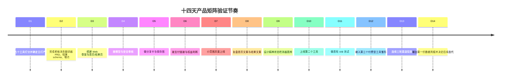

# 轻娱乐 AI 小工具产品矩阵执行报告

## 执行摘要

建议先用**老板消息翻译器**做破圈入口，再用**打工人精神状态检测器**承接传播，第三步补上**朋友圈阴阳怪气生成器**做付费扩展，最后再上线**朋友群角色测试**与**AI情绪抽卡**做社交裂变和轻留存。先做 **H5/Web App**，复用一套结果引擎、分享卡和支付层；开始收费后不要继续停留在 Vercel Hobby，因为该层级注明仅限非商业个人用途。移动应用和小程序的审核、隐私和支付摩擦更高，适合在 Web 验证后再上。citeturn10search0turn15view1turn16view5turn9search2

## 排序与矩阵策略

从商业上看，这五个产品不应该被当成五个独立 App，而应该被当成**一个内容引擎 + 五个前台皮肤**。原因很简单：它们的共性非常高，都是“输入一段文本或做一个选择 → 模型输出结构化结果 → 结果页生成分享海报 → 触发二次传播 → 再引流回站内其他工具”。这种结构特别适合用 Next.js 一套代码库跑多路由，也适合把支付、分享卡、埋点、风控全部共用。Next.js 官方明确支持全栈 Web 应用开发，并可部署为 Node 服务器、Docker 或 static export；Vercel 对 Next.js 提供预览部署与 HTTPS，适合快速验证。citeturn11search3turn11search1turn0search13

移动市场本身也支持“轻工具 + 变现优先”的路线。Sensor Tower 的 2026 报告显示，2025 年 iOS 与 Google Play 的应用内购和付费应用收入达到 1670 亿美元，同比增长 10.6%，而且**非游戏类收入首次超过游戏**；生成式 AI 是主要增长动力之一。对你这种小工具矩阵来说，这意味着不需要先追求海量下载，先把“分享率、付费点击率、留存”做出来更现实。citeturn10search0turn10search8

| 工具 | 传播性 | 实现成本 | 变现速度 | 综合优先级 | 排名理由 |
|---|---:|---:|---:|---|---|
| 老板消息翻译器 | 5 | 5 | 5 | 最高 | 需求一句话就懂；输入短、结果快；“真实含义 + 建议回复”同时兼顾实用与娱乐，最容易截图传播，也最容易做付费模式包 |
| 打工人精神状态检测器 | 5 | 4 | 4 | 很高 | 强共鸣，适合周一/周五场景；测试型内容天然适合海报分享；可做“深度报告”付费 |
| 朋友圈阴阳怪气生成器 | 4 | 4 | 4 | 高 | 直接解决发文案需求，实用性高；但内容安全压力更大，需要更严格的风控 |
| 朋友群角色测试 | 4 | 3 | 3 | 中高 | 裂变最好，但要处理邀请链路、群体关系和结果轻度“冒犯”问题，设计难度略高 |
| AI情绪抽卡 | 3 | 5 | 2 | 中 | 成本最低、日更最轻，但如果没有连续签到和主题卡包，付费深度通常最弱 |

建议上线顺序不是五个齐发，而是：

| 阶段 | 产品 | 目的 |
|---|---|---|
| 第一阶段 | 老板消息翻译器 | 跑通“实用+好笑+分享”闭环 |
| 第二阶段 | 打工人精神状态检测器 | 放大传播，建立流量池 |
| 第三阶段 | 朋友圈阴阳怪气生成器 | 验证直接付费能力 |
| 第四阶段 | 朋友群角色测试 | 打社交裂变 |
| 第五阶段 | AI情绪抽卡 | 做轻留存和补充流量入口 |

## 单品方案设计

### 老板消息翻译器

| 维度 | 设计 |
|---|---|
| 目标用户 | 22–35 岁职场人，特别是高频微信沟通、需求协作、乙方/产品/运营人群 |
| 核心价值 | 把“看不懂/不敢回/想吐槽”的职场消息，转成**真实含义 + 风险等级 + 体面回复** |
| 关键场景 | 收到老板催活；会后收到模糊需求；同事甩锅；客户催进度 |
| 北极星指标 | 结果页分享率 |
| 上线 KPI | 输入到生成转化率 ≥ 55%；结果页分享点击率 ≥ 15%；复制回复率 ≥ 20%；付费点击率 ≥ 4%；D1 ≥ 20%；D7 ≥ 8% |

| MVP 功能优先级 | 功能 |
|---|---|
| 必做 | 文本输入；风格模式选择（求生/体面/阴阳/发疯）；输出四段结构化结果；复制按钮；再次生成；海报分享；埋点 |
| 可选 | 示例词条；历史记录；语音输入；“更像老板/同事/客户”模式 |
| 后期 | 登录收藏；团队模式包；行业模板包；订阅制无限次 |

| 执行 SOP | 具体动作 |
|---|---|
| 3 天快速 MVP | D1：确定输出 schema 和四种风格；完成首页与结果页静态稿。D2：接 LLM、做 JSON 结构化输出、接复制与再生成。D3：接分享海报、Vercel 部署、接支付链接、开始灰度发群。 |
| 14 天验证 | D4–D7：投放微信群/朋友圈/即刻/小红书截图；看哪种风格分享率最高。D8–D10：测试“免费 3 次 vs 5 次”“先看结果后付费 vs 先看部分结果后付费”。D11–D14：上线高级模式包与“职场高情商回复库”，观察首批付费。 |

| UI/交互要点 | 设计建议 |
|---|---|
| 页面结构 | 首页 Hero → 输入框 → 风格切换 → 示例 chips → 生成按钮；结果页用 4 张信息卡依次展示 |
| 关键交互 | 生成后自动滚动到结果；底部固定“复制回复”和“生成海报”；结果支持“一键重写成更委婉/更硬气” |
| 分享卡文案模板 | 标题：**老板话术翻译结果：今晚别睡型**；副标题：原话「这个需求应该不复杂吧？」；正文：真实含义 / 风险等级 / 建议回复；CTA：**你也来翻一句** |
| 视觉建议 | 深色办公背景 + 对话气泡 + 高亮红黄风险 badge；避免太像真实聊天界面，减少侵权和误导 |
| 移动端适配 | 输入框高度≥120px；底部主按钮固定；键盘弹起时按钮置顶；结果卡片支持长按复制 |

| 留存、增长与变现 | 设计建议 |
|---|---|
| 首日留存 | 结果页附送“再试一句老板黑话”；让用户连续测 2–3 条 |
| 七日留存 | 周一上班版、周会版、客户版、年中述职版等主题模式轮播 |
| 裂变机制 | 分享海报 + 邀请解锁隐藏风格；“邀请 2 人解锁发疯版” |
| A/B 测试 | CTA 文案、默认风格、免费次数、海报风格、付费时机 |
| 付费路径 | 免费基础结果 → 付费解锁“高级回复/更多风格/批量翻译/历史收藏” |

| 技术与风险 | 设计建议 |
|---|---|
| 推荐模型 | 生产用低成本模型；严格 JSON 输出 |
| 单千次模型成本估算 | 以 450 输入 / 220 输出估算，GPT-5.4 mini 约 **$1.33/千次**；Claude Haiku 4.5 约 **$1.55/千次** |
| 主要风险 | 容易生成针对具体公司/个人的攻击性内容 |
| 缓解措施 | 输入输出双重审核；自动脱敏姓名、公司名、手机号；默认声明“娱乐表达，不用于真实工作决策” |

### 打工人精神状态检测器

| 维度 | 设计 |
|---|---|
| 目标用户 | 职场人、学生、通勤用户 |
| 核心价值 | 用 8–10 个轻问题生成“今日精神状态报告”，提供情绪价值和分享谈资 |
| 关键场景 | 周一上班、周五下班、开大会前、深夜群聊 |
| 北极星指标 | 完整测试完成率 |
| 上线 KPI | 开始测试率 ≥ 60%；测试完成率 ≥ 70%；海报分享率 ≥ 18%；D1 ≥ 24%；D7 ≥ 10% |

| MVP 功能优先级 | 功能 |
|---|---|
| 必做 | 8–10 题单选题；结果类型；3 个标签；1 条建议；海报保存 |
| 可选 | 每周趋势；“办公室人格搭子”推荐；周一/周五双模式 |
| 后期 | 连续签到；周报订阅；团队排行 |

| 执行 SOP | 具体动作 |
|---|---|
| 3 天快速 MVP | D1：设计题库和 6–8 个结果 archetype。D2：完成答题流程、结果映射与海报。D3：上线并在周一/周五测试两个投放版本。 |
| 14 天验证 | D4–D7：测试“纯规则结果 vs 规则 + LLM 润色”；D8–D10：增加“深度报告”付费点；D11–D14：做星期/时段入口，观察复访。 |

| UI/交互要点 | 设计建议 |
|---|---|
| 页面结构 | 首页说明 → 答题进度条 → 结果页 → 海报页 |
| 关键交互 | 题目切页要快；每题操作后即时反馈情绪 icon；结果页支持“重测一次” |
| 分享卡文案模板 | 标题：**今日精神状态：静音崩溃型**；副标题：发疯阈值 78%；正文：症状标签 + 生存建议；CTA：**测一下你今天还有几格电** |
| 视觉建议 | 渐变底色 + 大号人格标题 + 表情量表；风格可爱但不要太幼态 |
| 移动端适配 | 单手操作优先；题目按钮足够大；进度条显著；结果页首屏即可截图 |

| 留存、增长与变现 | 设计建议 |
|---|---|
| 首日留存 | 结果页给出“再测一次更准版本”；诱发重复测试 |
| 七日留存 | 周一模式、周三熬会模式、周五下班模式；形成节律入口 |
| 裂变机制 | 分享海报 + “同事也测一下”的 CTA；工作群天然扩散 |
| A/B 测试 | 题目数量、结果标签毒舌程度、海报布局、结果标题 |
| 付费路径 | 免费普通报告；付费深度报告、周趋势报告、专属海报主题 |

| 技术与风险 | 设计建议 |
|---|---|
| 推荐模型 | 先规则映射，后用模型润色，尽量降低 token 消耗 |
| 单千次模型成本估算 | 以 650 输入 / 280 输出估算，GPT-5.4 mini 约 **$1.75/千次**；Claude Haiku 4.5 约 **$2.05/千次** |
| 主要风险 | 容易被误解为心理诊断或情绪评估工具 |
| 缓解措施 | 页面明确写“娱乐测试，不构成心理/医疗建议”；避免输出病理化结论、避免自伤相关文案 |

### 朋友圈阴阳怪气生成器

| 维度 | 设计 |
|---|---|
| 目标用户 | 高频发朋友圈/小红书/微博的年轻用户 |
| 核心价值 | 给出“有梗但不直说”的文案，降低发内容门槛 |
| 关键场景 | 发泄情绪、暧昧表达、含沙射影、节日吐槽 |
| 北极星指标 | 文案复制率 |
| 上线 KPI | 生成转化率 ≥ 60%；复制率 ≥ 35%；付费点击率 ≥ 5%；D1 ≥ 18%；D7 ≥ 7% |

| MVP 功能优先级 | 功能 |
|---|---|
| 必做 | 输入一句真实想法；风格选择；输出 5 条候选文案；复制；保存长图 |
| 可选 | 配图建议；表情包建议；更短/更长重写 |
| 后期 | 主题包、节日包、恋爱/职场/友情频道 |

| 执行 SOP | 具体动作 |
|---|---|
| 3 天快速 MVP | D1：定义 6 种风格和安全边界。D2：接模型与候选文案列表。D3：上线结果海报、复制和付费门槛。 |
| 14 天验证 | D4–D7：测“输出 3 条 vs 5 条 vs 10 条”；D8–D10：测“免费首条 + 付费解锁其余”与“全部免费但高级风格收费”；D11–D14：新增节日/热点模板。 |

| UI/交互要点 | 设计建议 |
|---|---|
| 页面结构 | 首页输入框 → 风格选择 chips → 结果列表 → 复制/保存 |
| 关键交互 | 每条文案旁边一个复制按钮；支持“更狠一点/更克制一点”二次改写 |
| 分享卡文案模板 | 标题：**你的新朋友圈文案已到货**；正文预览：**风很轻，话不必讲太明。**；底部：风格标签 + CTA「复制同款」 |
| 视觉建议 | 黑白/编辑部杂志风；重点突出一句“可直接发”的文案 |
| 移动端适配 | 文案行高要舒服；支持一屏看 3 条；复制反馈要强烈 |

| 留存、增长与变现 | 设计建议 |
|---|---|
| 首日留存 | 生成后推荐另一个风格“再试一次” |
| 七日留存 | 节日主题、周末 mood、节气模板、热点模板 |
| 裂变机制 | 分享“我今天的阴阳浓度”；好友看链接可生成自己的版本 |
| A/B 测试 | 候选条数、默认风格、文案长度、是否显示“配图建议” |
| 付费路径 | 高级风格包、无限生成、节日模板包、私密模式 |

| 技术与风险 | 设计建议 |
|---|---|
| 推荐模型 | 尽量约束“针对情境而非针对具体个人攻击” |
| 单千次模型成本估算 | 以 520 输入 / 300 输出估算，GPT-5.4 mini 约 **$1.74/千次**；Claude Haiku 4.5 约 **$2.02/千次** |
| 主要风险 | 诽谤、骚扰、攻击具体个人或组织 |
| 缓解措施 | 禁止生成实名攻击、辱骂、造谣；遇到具体人名/公司名时自动改写为泛化表达；高风险输出直接拒答 |

### 朋友群角色测试

| 维度 | 设计 |
|---|---|
| 目标用户 | 朋友群、同学群、同事群活跃用户 |
| 核心价值 | 用轻测试给用户一个“群内身份标签”，并促发整群参与 |
| 关键场景 | 群里没话题；聚会前热场；发群玩梗 |
| 北极星指标 | 邀请点击率 |
| 上线 KPI | 开始测试率 ≥ 50%；分享到群率 ≥ 12%；二次回流率 ≥ 15%；D1 ≥ 22%；D7 ≥ 9% |

| MVP 功能优先级 | 功能 |
|---|---|
| 必做 | 6–8 题；角色结果；群内贡献标签；分享卡 |
| 可选 | 邀请后生成“群报告”；群里人设图谱 |
| 后期 | 多人联动测试；情侣/室友/项目组子版本 |

| 执行 SOP | 具体动作 |
|---|---|
| 3 天快速 MVP | D1：定义 8–10 个轻松角色，不要带侮辱。D2：完成答题和结果页。D3：做“发群查看你们群凑不凑得齐”的分享文案。 |
| 14 天验证 | D4–D7：看群分享后点击率；D8–D10：加“邀请 3 位朋友解锁群报告”； D11–D14：测角色命名、海报风格、标签轻重。 |

| UI/交互要点 | 设计建议 |
|---|---|
| 页面结构 | 首页说明 → 题目 → 结果页 → 邀请页 |
| 关键交互 | 结果页必须有“发群看看别人是什么角色”；邀请后返回页显示进度 |
| 分享卡文案模板 | 标题：**你在朋友群里是「气氛维护员」**；副标题：冷场修复 3 次 / 深夜出现率 92%；CTA：**发群看看谁是怨种王** |
| 视觉建议 | 贴纸风、群聊 icon、多人头像气泡 |
| 移动端适配 | 邀请按钮始终在首屏；弱化复杂导航，突出“转发”动作 |

| 留存、增长与变现 | 设计建议 |
|---|---|
| 首日留存 | 邀请回流天然提升 |
| 七日留存 | 换一个群重新测、情侣版/同事版/室友版 |
| 裂变机制 | 发群解锁群报告，最适合自然裂变 |
| A/B 测试 | 角色名字、邀请文案、是否显示“群报告进度” |
| 付费路径 | 群报告、更多角色包、定制海报包 |

| 技术与风险 | 设计建议 |
|---|---|
| 推荐模型 | 角色结果可规则化，群报告再调用模型 |
| 单千次模型成本估算 | 以 700 输入 / 320 输出估算，GPT-5.4 mini 约 **$1.97/千次**；Claude Haiku 4.5 约 **$2.30/千次** |
| 主要风险 | 群体关系被激化，角色标签太冒犯 |
| 缓解措施 | 只用轻松标签；避免“废物/舔狗/low”等贬损词；群报告里不排名羞辱 |

### AI情绪抽卡

| 维度 | 设计 |
|---|---|
| 目标用户 | 轻度娱乐用户、喜欢每日打卡和小仪式感的人 |
| 核心价值 | 用“今日人设牌/情绪牌”制造低门槛日常打开理由 |
| 关键场景 | 早上通勤、午休、睡前发朋友圈 |
| 北极星指标 | 人均抽卡次数 |
| 上线 KPI | 首屏抽卡率 ≥ 70%；保存海报率 ≥ 15%；D1 ≥ 25%；D7 ≥ 12% |

| MVP 功能优先级 | 功能 |
|---|---|
| 必做 | 抽卡；卡名；一句解读；今日建议；海报 |
| 可选 | 重抽一次；卡册；主题卡面 |
| 后期 | 连续签到、卡包活动、好友互抽 |

| 执行 SOP | 具体动作 |
|---|---|
| 3 天快速 MVP | D1：设计 30–50 张卡与卡面风格。D2：完成功能和海报。D3：上线“今日可抽 1 次，分享得 1 次重抽”。 |
| 14 天验证 | D4–D7：测每日刷新 vs 随时可抽；D8–D10：测试主题卡包；D11–D14：补节日主题和签到。 |

| UI/交互要点 | 设计建议 |
|---|---|
| 页面结构 | 首页单按钮抽卡 → 卡面页 → 结果解读 → 保存/重抽 |
| 关键交互 | 动效要短，不可拖慢；结果页优先展示卡名和一句话 |
| 分享卡文案模板 | 标题：**今日人设牌：已读乱回型**；副标题：今日建议——下午不要接语音；CTA：**抽你今天的牌** |
| 视觉建议 | 塔罗牌 / 贴纸风 / 拼贴风，风格统一即可 |
| 移动端适配 | 单手点击、轻动效、低学习成本 |

| 留存、增长与变现 | 设计建议 |
|---|---|
| 首日留存 | 分享得重抽、收集不同稀有卡 |
| 七日留存 | 每日换卡、连续签到、限定卡包 |
| 裂变机制 | 今日卡片海报最适合朋友圈，但社交链深度弱于群测试 |
| A/B 测试 | 动效时长、卡面风格、稀有度文案、重抽门槛 |
| 付费路径 | 主题卡包、稀有卡面、去广告、无限重抽 |

| 技术与风险 | 设计建议 |
|---|---|
| 推荐模型 | 以规则卡库为主，模型负责解读润色 |
| 单千次模型成本估算 | 以 280 输入 / 160 输出估算，GPT-5.4 mini 约 **$0.93/千次**；Claude Haiku 4.5 约 **$1.08/千次** |
| 主要风险 | 纯娱乐但容易“空”，付费弱 |
| 缓解措施 | 设计固定卡库 + 签到 + 主题包，不要只靠一次性新鲜感 |

## 共用技术、设计与部署方案

### 推荐的共用技术栈

| 层 | 推荐方案 | 说明 |
|---|---|---|
| 前端 | Next.js App Router + TypeScript | 一套代码库做五个路由，利于快速出功能和 SEO |
| UI | Tailwind CSS + shadcn/ui | Tailwind 零运行时、适合快速样式迭代；shadcn/ui 提供可访问、开源可改的组件底座 |
| 后端 | Next.js Route Handlers / Server Actions | 对五个工具都够用 |
| 数据库 | Supabase Postgres | 先存埋点、订单、限流记录；后续再存用户历史 |
| 鉴权 | 先不做登录；后续用 Supabase Auth + RLS | 有用户历史或付费权益时再加 |
| 分享图 | `@vercel/og` | 动态生成 OG 卡片与结果海报 |
| 支付 | 海外优先 Stripe Payment Links；备选 Lemon Squeezy | Web 起步最快 |
| 内容审核 | OpenAI Moderation + 关键词黑白名单 | 输入输出双检 |
| 埋点 | 先自建 event 表到 Supabase | 足够跑 MVP，不必早上第三方分析平台 |

这套方案的依据比较明确：Next.js 官方把自己定义为全栈 React 框架，并支持 Node 服务器、Docker 与 static export；Vercel 对 Next.js 提供预览部署和 HTTPS。Tailwind 强调零运行时、扫描模板生成静态 CSS；shadcn/ui 提供 open code、可访问组件。Supabase 的定价页提供起步资源，Auth 可与 RLS 搭配；RLS 文档明确建议在暴露 schema 的表上启用策略，并说明它与 Auth 组合可形成 browser-to-database 的防护。citeturn11search3turn11search1turn3search8turn3search1turn0search2turn15view4turn14search1

需要特别注意的是：**Vercel Hobby 只适合内部验证和个人预览，不适合收费后长期商用**。Vercel Hobby 文档写明它是免费层，适合个人项目和小规模应用，但 fair use 限定为**non-commercial, personal use only**。因此建议你在内部验证或朋友测试阶段用 Hobby；一旦啟动 Ads、收费或持续商用，就迁移到 Pro 或可商业使用的托管。citeturn15view1

### 模型调用与成本控制

推荐你把五个工具都做成**结构化输出**。OpenAI 的 Structured Outputs 文档明确说明，它可以让模型稳定遵循 JSON Schema，减少漏字段、错误枚举和值格式异常；Responses API 则是官方推荐的统一接口。对这五个工具来说，这意味着你可以统一返回 `title`、`subtitle`、`insights[]`、`cta`、`risk_level` 这类固定字段，前端渲染会非常稳定。citeturn16view2turn7search10turn7search8

如果要控制成本，建议把模型分成两层：

| 场景 | 推荐模型 | 原则 |
|---|---|---|
| 开发调 prompt | GPT-5.5 / Claude Sonnet 4.6 | 少量使用，追求调试效率 |
| 线上生成结果 | GPT-5.4 mini 或 Claude Haiku 4.5 | 追求低成本、低延迟 |
| 内容审核 | OpenAI Moderation | 免费、放在输入前和输出后 |

OpenAI 当前公开页面列出了 GPT-5.4 mini 的价格为 **$0.75/输入 MTok**、**$4.50/输出 MTok**；Anthropic 模型总览列出了 Claude Haiku 4.5 的价格为 **$1/输入 MTok**、**$5/输出 MTok**。OpenAI 的 Prompt Caching 文档说明，重复长前缀情况下，输入成本最多可下降 90%，延迟最多可下降 80%；Moderation 文档则明确 Moderation 接口免费。citeturn2search3turn16view1turn7search0turn16view3

按比较保守的输入/输出 token 估算，五个工具的模型成本可以控制在很低水平：

| 工具 | 估算输入/输出 | GPT-5.4 mini | Claude Haiku 4.5 |
|---|---:|---:|---:|
| 老板消息翻译器 | 450 / 220 | 约 $1.33 / 千次 | 约 $1.55 / 千次 |
| 打工人精神状态检测器 | 650 / 280 | 约 $1.75 / 千次 | 约 $2.05 / 千次 |
| 朋友圈阴阳怪气生成器 | 520 / 300 | 约 $1.74 / 千次 | 约 $2.02 / 千次 |
| 朋友群角色测试 | 700 / 320 | 约 $1.97 / 千次 | 约 $2.30 / 千次 |
| AI情绪抽卡 | 280 / 160 | 约 $0.93 / 千次 | 约 $1.08 / 千次 |

成本控制要点只有四个：第一，**结果尽量规则化**，不要让模型从零发明完整世界观；第二，**系统提示词固定且不要过长**，把品牌语气与安全规则抽成静态模版；第三，**对同输入做 hash 缓存**，减少重复生成；第四，**先规则再模型**，例如抽卡和角色测试可先规则判型，再让模型润色。OpenAI Prompt Caching 和 Anthropic Prompt Caching 都支持重复前缀复用；但只有在前缀足够长且复用度高时才值回票价。citeturn7search0turn8search7

### 分享卡与移动端适配

分享是这类产品的生命线。Vercel 的 OG 文档说明，`@vercel/og` 可以用 HTML/CSS 动态生成社交卡片，而且会自动给生成结果加 CDN 缓存头，降低重复生成成本；其 OG 预览文档还给出了实操建议：`title` 建议控制在 70 字符以内，`description` 在 200 字符以内，`og:image` 使用绝对 URL，适合你把每条结果自动变成分享卡。citeturn15view3turn17view5

建议所有工具都共用一张结果卡布局，减少设计与开发成本：

```text
┌────────────────────────────────────┐
│  [品牌角标]   今日结果 / 测试结果      │
│                                    │
│  大标题：静音崩溃型 / 今晚别睡型       │
│  副标题：一句最能截图传播的话          │
│                                    │
│  关键点 1：结果标签 / 风险等级         │
│  关键点 2：一句建议 / 一句吐槽         │
│                                    │
│  #工具名  ·  立即测你自己的版本        │
│  logo / URL / 小二维码                │
└────────────────────────────────────┘
```

五个工具可直接复用的分享卡文案如下：

| 工具 | 标题模板 | 副标题模板 | CTA | 视觉关键词 |
|---|---|---|---|---|
| 老板消息翻译器 | 老板话术翻译结果：{{type}} | 原话：{{quote}} | 你也来翻一句 | 深色办公、对话气泡、风险 badge |
| 精神状态检测器 | 今日精神状态：{{type}} | 发疯阈值 {{score}}% | 测你今天还有几格电 | 渐变、量表、emoji |
| 阴阳怪气生成器 | 你的新朋友圈文案已到货 | {{one_liner}} | 复制同款 | 黑白杂志、重点句高亮 |
| 情绪抽卡 | 今日人设牌：{{card_name}} | 今日建议：{{advice}} | 抽你今天的牌 | 卡牌、拼贴、霓虹 |
| 群角色测试 | 你在朋友群里是「{{role}}」 | 群聊贡献值 {{score}} | 发群看看别人是什么角色 | 贴纸、群聊头像、对话泡泡 |

如果你后续上微信小程序，要注意两件事。第一，想把结果发到微信朋友和朋友圈，需要分别配置 `onShareAppMessage` 与 `onShareTimeline`；第二，朋友圈打开的小程序页会进入**单页模式**，没有登录态、不能跳其他页、也不能横屏，所以分享落地页必须做成一个**自包含、无登录、单页可读**的结果页。腾讯云开发者社区对这一点有很清楚的说明。citeturn17view6

## 增长、定价与运营模板

### 免费到付费的路径

Web 端最适合的支付路径不是“先做复杂账户体系”，而是**先做免费层 + 一次性付费点**。Stripe Payment Links 官方文档显示，它支持**无需写代码**直接创建可分享支付链接，可用于**产品、订阅或捐赠**；链接可复用，可加 UTM，可做二维码，可支持 40+ 支付方式和 30+ 语言。对早期 MVP 来说，这比自己接完整支付流更快。citeturn15view2

Lemon Squeezy 也适合卖数字产品与 SaaS，支持免费注册和测试模式，但它的 prohibited products 页面明确写了：**services of any kind**（包括营销、设计、网页开发、咨询等服务）在禁售范围内。也就是说，如果你卖的是“高级功能订阅”“模板包”“卡包”，它适合；如果你卖的是“我帮你代写/定制服务”，就不适合。citeturn16view6turn3search11turn3search15

建议定价从简单开始：

| 层级 | 设计 | 建议价格 |
|---|---|---:|
| 免费层 | 每日 3 次；基础结果；基础海报 | 0 |
| 单次增购 | 本次结果解锁高级模式 / 更多结果 / 高清海报 | ¥2.9–¥6.9 |
| 主题包 | 节日包、职场包、情侣包、发疯包 | ¥6.9–¥12.9 |
| 月会员 | 无限生成 + 全风格 + 历史记录 + 无广告 | ¥19–¥39 |
| 工具矩阵包 | 五个工具通用权益 | ¥29–¥49 |

更具体的付费设计建议是：

| 工具 | 最适合的付费点 |
|---|---|
| 老板消息翻译器 | 更多风格、批量翻译、回复模板库 |
| 精神状态检测器 | 深度报告、周趋势、专属海报 |
| 阴阳怪气生成器 | 高级风格包、节日包、无限生成 |
| 群角色测试 | 群报告、多人版、人设图谱 |
| 情绪抽卡 | 卡包、限定主题、无限重抽 |

### 增长与留存机制

首日留存别靠“账号体系”，要靠**第二次使用动机**。这类工具最有效的路径是：

| 层级 | 动作 |
|---|---|
| 首次体验 | 一句输入 / 一次抽卡 / 8 题答完 |
| 第一次强化 | “再来一次更准/更毒/更委婉” |
| 第一次分享 | 海报按钮始终可见 |
| 第二次回来 | 主题模式、周一版、节日版、好友邀请解锁 |
| 第一次付费 | 解锁高级模式、更多候选、高清海报 |

A/B 测试优先级建议如下：

| 测试项 | 先测什么 |
|---|---|
| 首屏文案 | “测一测” vs “翻译一下” vs “生成一下” |
| 免费次数 | 1 / 3 / 5 次 |
| 先看结果还是先付费 | 完整免费首条 vs 半结果预览 |
| 海报风格 | 杂志风 / 对话风 / emoji 风 |
| 结果长度 | 一屏可读 vs 长图深报告 |

## 交付物模板与 Prompt 模板

### 交付物清单

| 交付物 | 最小模板 |
|---|---|
| PRD 简版 | 问题、目标用户、核心场景、MVP、KPI、非目标、风控 |
| 用户故事 | 作为某类用户，我希望输入/答题/抽卡后，快速得到可分享结果 |
| 接口文档 | `POST /api/generate`；入参 `tool_id`、`mode`、`input`；出参统一 JSON |
| 测试用例 | 空输入、极长输入、涉敏输入、重复点击、支付后权益、海报生成 |
| 上线检查表 | 域名、埋点、风控、支付、分享图、404、robots、sitemap、客服入口 |
| 客服 FAQ | 怎么收费、为什么结果不一样、能否退款、如何删除记录、为什么不给生成 |
| 数据埋点表 | page_view、generate_click、generate_success、share_click、share_success、paywall_view、checkout_click、payment_success、retry_click |

### PRD 简版模板

```markdown
产品名：
一句话定位：
目标用户：
核心场景：
用户痛点：
核心价值：
MVP 功能：
关键页面：
首月 KPI：
风控范围：
非目标：
```

### 接口文档示例

```http
POST /api/generate
Content-Type: application/json

{
  "tool_id": "boss_translator",
  "mode": "求生版",
  "input": "这个需求不复杂吧，今天能给我一个版本吗？"
}
```

```json
{
  "ok": true,
  "data": {
    "title": "今晚别睡型",
    "subtitle": "这句话的真实含义是：今晚需要可见结果",
    "insights": [
      "风险等级：高",
      "建议回复：我先给您同步影响范围，今晚先出初版。"
    ],
    "share_line": "你也来翻一句老板黑话",
    "safety_flags": []
  }
}
```

### 测试用例模板

| 用例 | 输入 | 预期 |
|---|---|---|
| 空输入 | `""` | 提示用户输入内容，不调用模型 |
| 极长输入 | 2000+ 字 | 截断并提示长度限制 |
| 涉敏输入 | 实名辱骂、攻击群体 | 触发拒答或安全改写 |
| 快速重复提交 | 连续点 3 次 | 按钮 loading，禁止重复扣费 |
| 支付后权益 | 成功支付 | 即时解锁高级模式 |
| 分享海报 | 结果生成后 | 正常生成 PNG/WebP，移动端可保存 |

### 埋点表模板

| 事件 | 属性 |
|---|---|
| `page_view` | `tool_id`、`source_channel`、`utm_campaign` |
| `generate_click` | `tool_id`、`mode`、`input_len_bucket` |
| `generate_success` | `tool_id`、`mode`、`result_type`、`latency_ms` |
| `share_click` | `tool_id`、`share_variant`、`result_type` |
| `paywall_view` | `tool_id`、`entry_point`、`free_used_count` |
| `checkout_click` | `tool_id`、`plan_id` |
| `payment_success` | `tool_id`、`plan_id`、`amount` |
| `retry_click` | `tool_id`、`mode` |
| `helpful_vote` | `tool_id`、`result_type`、`vote` |

### 可直接复制的 Prompt 模板

#### 用于生成产品首页文案

```text
你是资深增长型产品文案。请为一个中文移动端 Web App 生成首页文案。

产品名：{{product_name}}
一句话功能：{{one_liner}}
目标用户：{{target_user}}
用户场景：{{scenes}}
品牌语气：轻松、清晰、可分享、不过度营销

请输出：
1. 首页主标题（10字内，抓人）
2. 副标题（20字内，说明价值）
3. 首屏按钮文案（2个版本）
4. 3条卖点文案（每条12字内）
5. 示例输入占位文案
6. 结果页 CTA 文案（2个版本）
7. 付费弹层标题 + 副标题
要求：中文、口语化、适合截图和移动端。
```

#### 用于生成分享卡文案

```text
你是社交传播文案策划。请为分享卡生成短文案。

产品名：{{product_name}}
结果类型：{{result_type}}
结果摘要：{{summary}}
目标分享渠道：{{channel}}  # 微信/朋友圈/小红书/群聊
限制：
- 标题 18 字内
- 副标题 26 字内
- CTA 8 字内
- 不攻击具体个人
- 适合年轻职场用户传播

请输出 JSON：
{
  "title": "",
  "subtitle": "",
  "cta": "",
  "hashtags": ["", ""],
  "visual_keywords": ["", "", ""]
}
```

#### 用于对话/结果生成的模型 Prompt

```text
你是一个中文轻娱乐产品的结果生成引擎。

工具：{{tool_name}}
模式：{{mode}}
用户输入：{{user_input}}

安全要求：
- 不输出对具体个人、公司、学校的诽谤、辱骂、造谣内容
- 不输出医疗诊断、法律建议、财务建议
- 遇到明显攻击性输入时，转为泛化、轻松、非指向性表达
- 结果应兼顾“可分享”和“可读性”，但不要过长

请严格按 JSON 输出：
{
  "title": "结果标题，6-12字",
  "subtitle": "一句总结，18字内",
  "insights": ["要点1", "要点2", "要点3"],
  "share_line": "适合放在海报底部的一句话，16字内",
  "risk_level": "low|medium|high",
  "safety_flags": []
}
```

示例输入：

```json
{
  "tool_name": "老板消息翻译器",
  "mode": "求生版",
  "user_input": "这个需求不复杂吧，今天能给我一个版本吗？"
}
```

示例输出：

```json
{
  "title": "今晚别睡型",
  "subtitle": "对方想今天看到可交付物",
  "insights": [
    "真实含义：今晚要有阶段性结果",
    "风险等级：高",
    "建议回复：我先同步影响范围，今晚给您初版"
  ],
  "share_line": "你也来翻一句老板黑话",
  "risk_level": "high",
  "safety_flags": []
}
```

## 风险、合规与首月行动计划

### 风险与应对

| 风险 | 具体表现 | 缓解措施 |
|---|---|---|
| 内容安全 | 阴阳文案、人设测试可能生成人身攻击、造谣、群体歧视 | 输入前 + 输出后双审核；黑名单词库；高风险场景直接拒答或泛化 |
| 平台审核 | 原生 App 会被审查内容、支付、设计与法律问题 | 先做 Web；原生前再适配 App Review |
| iOS 支付 | 数字内容、订阅在原生 App 中涉及 IAP 规则 | 原生前再上 IAP；Web 先用 Stripe/LS |
| 微信小程序隐私 | 处理个人信息需要隐私保护指引 | MVP 阶段不登录、不采集头像昵称、不默认存原始输入；上小程序前补齐隐私文档 |
| 微信小程序分享限制 | 朋友圈单页模式无登录态、不可跳页 | 结果页必须单页自足，不依赖会话 |
| 隐私 | 用户输入可能含姓名、电话、公司名 | 默认不保存原始输入；供应日志只存哈希和统计；导出时脱敏 |
| 模型幻觉 | 结果太“真”被用户误认为建议或判断 | 全站显著标注“娱乐工具”；避免输出医学/法律/HR判断 |
| 版权与抄袭 | 海报过像微信聊天或某爆款 App | 自建视觉系统，不复刻平台 UI 和图标 |

内容合规的技术底座建议优先用 OpenAI Moderation，因为官方文档明确其 Moderation 端点免费，可同时检查文本与图片。若你做微信小程序，腾讯云文档和社区资料都提醒：处理个人信息的小程序要适配隐私保护指引；如果用户可生成或上传内容，应接入内容安全检测。腾讯云的图片内容安全首开有 3000 张试用额度，适合先验证。citeturn16view3turn8search4turn9search2turn9search8turn9search0turn9search15

原生 iOS 上线前也别低估审核摩擦。Apple 的 App Review Guidelines 把审核维度明确分成 Safety、Performance、Business、Design、Legal 五块，而 IAP 文档明确数字商品、虚拟内容和订阅应通过应用内购买体系处理。因此，**先 Web，后原生**，不是妥协，而是效率更高的商业顺序。citeturn16view5turn6search3turn6search5

### 首月运营计划

首月不是“五个工具全做完”，而是**先把一个跑通，再把第二个接进来**。下面这张表是你可以直接照着做的版本。

| 天数 | 任务 | 目标 | 交付物 | KPI |
|---|---|---|---|---|
| D1 | 给 5 个工具打分，确定顺序 | 选定第一款与第二款 | 优先级表、KPI 表 | 1 个主产品 + 1 个备产品确定 |
| D2 | 完成老板消息翻译器 PRD 与 schema | 统一结果结构 | PRD、接口 schema、埋点表 | PRD 定稿 |
| D3 | 搭项目骨架与首页 | 可本地跑通 | Next.js 项目、首页、结果页壳子 | 本地可访问 |
| D4 | 接模型、接安全审核 | 可完整生成结果 | `/api/generate`、审核链路 | 生成成功率 > 90% |
| D5 | 做分享卡和保存图 | 结果可截图传播 | OG 图模板、移动端海报页 | 海报生成成功率 > 95% |
| D6 | 接支付链接与权益判断 | 有变现入口 | Stripe/LS 链接、付费弹层 | 付费链路可测试 |
| D7 | 上线灰度，先发私域 | 看首轮真实反馈 | 正式域名、埋点生效 | 首日 UV 100+ |
| D8 | 复盘文案与结果 | 提升转化 | 新首页文案、新结果风格 | 输入转化率提升 10% |
| D9 | 做精神状态检测器题库与结果 archetype | 准备第二款 | 题库表、结果模板 | 题库完成 |
| D10 | 上线精神状态检测器 | 扩大流量入口 | 第二个路由 + 分享卡 | 累计 UV 300+ |
| D11 | 做 A/B：免费次数、CTA、海报风格 | 提升分享率 | A/B 表与变体 | 分享率 > 12% |
| D12 | 接入朋友圈阴阳怪气生成器最小版 | 试付费能力 | 第三个路由 | 复制率 > 25% |
| D13 | 小红书/即刻/群里连续发 3 轮素材 | 找到有效渠道 | 9 条图文/短视频素材 | 累计 UV 800+ |
| D14 | 复盘留存、分享、付费 | 决定第 3–4 周重心 | 数据周报、产品决策单 | 首批付费 5–20 单 |



首月后半段建议这样安排：

| 阶段 | 重点 | KPI |
|---|---|---|
| 第三周 | 把传播最好的工具打磨到分享率 > 15%，把第二个工具做到 20% 以上复访 | 累计 UV 2000+，付费率 1%–3% |
| 第四周 | 上线群角色测试或情绪抽卡做裂变/留存，开始做矩阵首页与权益打通 | 累计 UV 5000+，累计付费 50–100 单 |

### Open questions / limitations

本报告优先给出高置信、可执行的路线，但仍有几处依赖你的实际主体与地区，当前资料未完全指定：

| 问题 | 当前状态 |
|---|---|
| 国内 Web 支付与小程序内支付的最终选型 | 未指定；建议先 Web 手动收款或本地支付方案，后续再按主体与类目补接 |
| 微信小程序具体类目与广告/支付资格 | 未指定；不同主体与类目要求会影响审核 |
| 你是否计划面向海外卖订阅 | 未指定；若只面向中文私域，Stripe/Lemon Squeezy 的优先级会下降 |
| 你是否要保存用户原始输入历史 | 未指定；若保存，需要更严格隐私与删除机制 |

综合来看，**最值得立刻执行的路径**不是同时做五个，而是用一套共用底层先把**老板消息翻译器**做成“会被发群、会被截图、有人愿意为高级模式付钱”的版本；只要这条闭环跑通，另四个工具就不是从零开始，而是在同一引擎上不断复制。