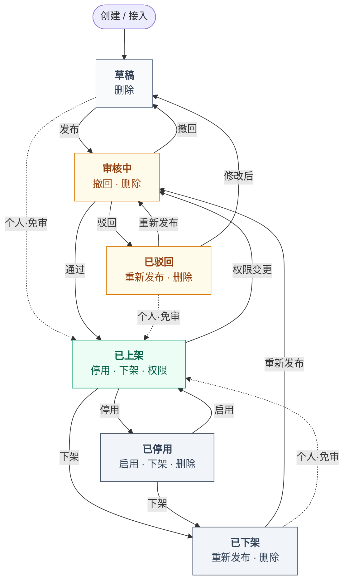

# 智能体生命周期：状态与卡片功能（v1.1）

> 运营平台卡片 `⋯` 菜单口径。点卡片主体 = 查看详情；审核通过/驳回 = 审核工作台。

## 状态 × 说明 × 功能卡片

| 状态 | 说明 | 功能卡片 |
| --- | --- | --- |
| 草稿 | 未对外，配置未完成或驳回后修改中 | 删除 |
| 审核中 | 已提交发布申请，等审批 | 撤回、删除 |
| 已上架 | 已对目标范围用户可用 | 停用、下架、权限 |
| 已停用 | 暂停用户访问，版本和范围保留，可再次启用 | 启用、下架、删除 |
| 已下架 | 已从用户可用入口移除，但历史记录保留 | 重新发布、删除 |
| 已驳回 | 审核未通过，需修改后再发布或删除 | 重新发布、删除 |

**补充规则**

- 第三方智能体：已上架卡片不含「权限」。
- 可见范围：个人免审直接上架；组织/公开须审核（见 `Proto.requiresPublishAudit`）。

## 状态流转

**读图说明**

- **实线**：常规状态迁移（须审核或运营操作）
- **虚线**：个人范围发布/重新发布，**免审**直达已上架
- **删除**：草稿、审核中、已驳回、已停用、已下架均可删除（不单独画线，避免交叉）

## 实现归属

| 区域 | 文件 |
| --- | --- |
| v1.1 卡片菜单 | `prototype/assets/ops-v11-app.js` → `cardMenuItems` |
| 发布审核规则 | `prototype/assets/proto.js` → `requiresPublishAudit` / `runAgentPublish` |
| v1.0 列表标签 | `prototype/assets/proto.js` → `statusLabel` |
