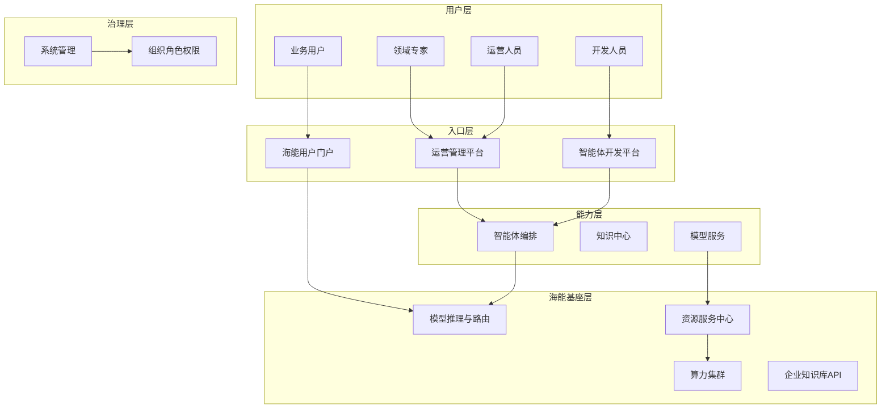
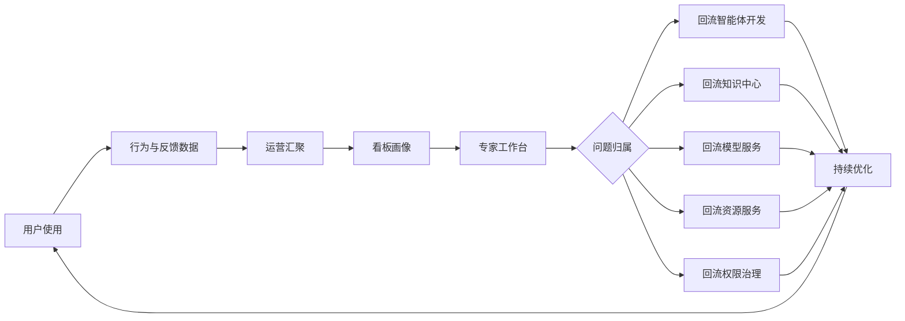

# 01 — 运营全景与模式图

**状态**：已定稿（产品层）  
**对应原始需求**：第 1 条「做运营全景/模式图」  
**英文 ADR 补充**：`docs/architecture/2026-06-08-ops-panorama.md`

---

## 1. 一句话定位

AI 应用开发平台以**运营管理平台为中枢**，把智能体开发、模型服务、知识中心、海能资源基座、系统治理串成：

**建设 → 使用 → 反馈 → 优化** 的企业级闭环。

---

## 2. 图层级说明（L0–L4）

| 层级 | 名称 | 用途 | 主要读者 |
|------|------|------|----------|
| **L0** | 产品全景图 | 六层架构 + 四类参与者 | 领导演示、对外宣讲 |
| **L1** | 运营闭环模式图 | 使用→数据→专家→回流 | 讲清「运营是中枢」 |
| **L2** | 双平台协作图 | 运营⇄开发 五个环节 | 研发拆 API |
| **L3** | 智能体生命周期 | 创建→发布→使用→下架 | 智能体运营 PRD |
| **L4** | 运营子模块导航 | 反馈/专家/看板/权限 | Figma/原型对齐 |

---

## 3. L0 — 产品全景（六层）

**顶层模块命名**（与讲稿、原型顶栏一致）：

智能编码伙伴 · 资源服务中心 · 模型服务 · 智能体开发 · 知识中心 · **运营平台**

---

## 4. L1 — 运营闭环模式

**各阶段数据类型**

| 阶段 | 数据 |
|------|------|
| 使用 | 会话日志、Token、知识命中、工具调用 |
| 汇聚 | 用户反馈、专家任务、审核流 |
| 分析 | 业务/模型/资源看板、用户智能体画像 |
| 回流 | 回流工单（关联 agent_id、feedback_id） |

---

## 5. L2 — 双平台五个协作环节

| # | 环节 | 触发时机 | 负责写/读 |
|---|------|----------|-----------|
| ① | 同步创建智能体 | 运营点「确定创建」 | 运营写主数据，开发镜像注册 |
| ② | 获取可用资源 | 进入开发编辑器 | 开发读，权限过滤 |
| ③ | 同步配置摘要 | 开发每次保存 | 开发写，运营只读摘要 |
| ④ | 发起对话 | 沙箱 / 用户门户 | 运行时调海能推理 |
| ⑤ | 回传运行数据 | 监控 / 看板刷新 | 海能产出，运营消费 |

原型说明页：`prototype/01-architecture.html`、`02-sequence-create.html`

---

## 6. L3 — 智能体生命周期（摘要）

开发中 → 待发布 → 审核中（全公司）→ 已上架 → 已停用 / 已下架

详表见根目录 [`运营平台-智能体运营.md`](../../运营平台-智能体运营.md) 第 4 章。

---

## 7. L4 — 运营子模块（原型入口）

| 模块 | 原型页面 | 文档状态 |
|------|----------|----------|
| 智能体运营 | `index.html`、`05-agent-detail.html` | PRD 完整 |
| 用户反馈 | `11-user-feedback*.html` | 文档有，Figma 部分 partial |
| 专家工作台 | `12-expert-*.html` | 文档有，交互菜单缺 |
| 业务/模型/资源/画像看板 | `14-*.html` | **文档已补，演示数据为 mock** |
| 权限与开发者 | `13-permission-*.html` | 文档有，Peak Indicator 缺 |
| 审核工作台 | `08-audit-*.html` | PRD + 原型 PASS |
| 海能用户门户 | `09-user-chat.html` | ADR 用户端极简 |

---

## 8. 设计理念（五条，支撑全景）

1. **运营中枢** — 上线后的优化由运营驱动，不是各子系统各自为政。  
2. **双平台分工** — 运营管状态/治理/发布；开发管编排/调试。  
3. **Agent 一等公民** — 资源从属智能体，运营侧不建独立资源中心。  
4. **用户端极简** — 门户只暴露对话，不前台化后台。  
5. **海能做基座、我们做应用** — 算力/推理/企业知识 API 走海能。

---

## 9. 与讲稿的对应关系

| 讲稿章节 | 本图层级 |
|----------|----------|
| §2 六层产品设计 | L0 |
| §3 运营平台串联 | L1 |
| §5 数据闭环 | L1 下半段 |
| §8 子系统关系 | L0 + L4 |
| 智能体开发规范 §6 | L3 延伸 |

讲稿路径：`平台项目资料/AI中台系统功能介绍与演示讲稿-纯文本.md`
