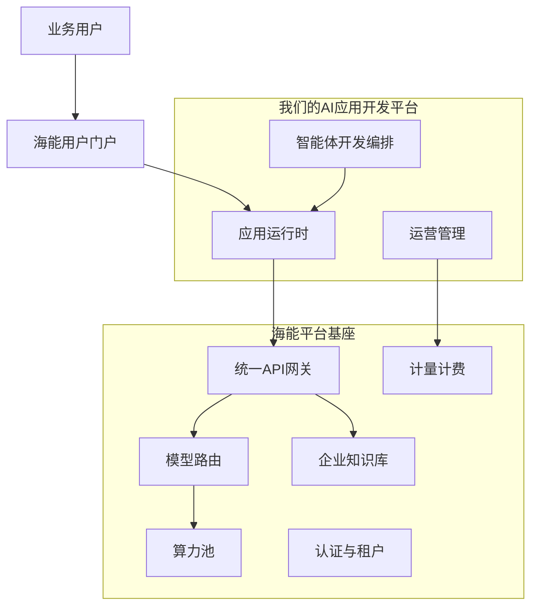

# 03 — 海能平台集成规范

**状态**：草案 v0.1（待海能侧工作坊确认）  
**对应原始需求**：第 4 条「和海能平台的关系、算力、智能体打通」  
**已确认关系**：**海能 = 底层基座**；**我们平台 = 应用层扩展**

---

## 1. 分层定位

---

## 2. 职责边界

| 能力 | 我们平台 | 海能基座 |
|------|----------|----------|
| 智能体画像/提示词/Skills/工作流 | ✓ 拥有 | — |
| 发布审核/运营治理 | ✓ 拥有 | — |
| 用户可见模型档位 | 标准/增强/专业/旗舰 | 映射实际模型与池 |
| 推理执行 | 组装上下文后调用 | 路由 + GPU |
| 企业知识检索 | 配置接入域 | CorpKB API |
| Token/GPU 监控 | 消费展示 | 产出 |
| SSO | 消费 | IAM 签发 |

**我们不做的**：直接调度 GPU 节点、替换海能路由策略、重复建设组织主数据。

---

## 3. 智能体如何与海能打通

| 步骤 | 我们做什么 | 调海能什么 |
|------|------------|------------|
| 定义智能体 | 画像、提示词、Skills、工作流 | — |
| 选模型 | 用户选档位（不暴露供应商） | 路由策略 |
| 接知识 | 配置知识域 ID | 检索/问答 API |
| 跑会话 | 组装 prompt + skills + KB | LLM 推理 |
| 看效果 | 运营看板、监控摘要 | Meter + 日志 |
| 用户登录 | 嵌入海能门户品牌 | SSO |

用户门户原型已体现：`09-user-chat.html` —「海能·智能助手」、企业知识库来源、四档模型名。

---

## 4. 算力使用路径

1. **开发调试**：开发预览 → 应用运行时 → 海能网关 → GPU 池 → 流式响应  
2. **正式发布**：`agent_id` + `model_tier` + 租户 → 海能按策略选池  
3. **成本治理**：资源看板 ← 海能计量；运营按智能体/部门聚合 Token  
4. **弹性**：高峰海能扩池；我们只配优先级/配额/档位上限  

---

## 5. 模型档位映射（不对用户暴露供应商）

| 用户档位 | 典型场景 | 海能池（示例名） |
|----------|----------|------------------|
| 标准模型 | 日常问答 | general-7b 池 |
| 增强模型 | 多轮对话 | general-32b 池 |
| 专业模型 | 专业文档/代码 | 领域微调池 |
| 旗舰模型 | 复杂推理/长上下文 | flagship 池 |

**待工作坊**：实际模型名、池 ID、配额策略签字表。

---

## 6. 核心 API 契约（v0.1）

| 接口 | 用途 | 关键字段 |
|------|------|----------|
| POST /agents/sync | 双平台创建同步 | agent_id, owner, scope, status |
| GET /models/available | 编辑器资源列表 | tier, quota, permission |
| POST /config/sync | 配置摘要同步 | prompt_version, skill_ids, model_tier |
| POST /inference/chat | 对话推理 | agent_id, model_tier, messages |
| POST /knowledge/retrieve | 知识检索 | kb_ids, query, trace_id |
| GET /metrics/usage | 运营看板 | tokens, latency, error_rate |
| POST /feedback/events | 用户反馈上报 | session_id, agent_id, category |

错误码建议：`HN_AUTH_401`、`HN_QUOTA_429`、`HN_ROUTE_503`、`HN_KB_404`。

---

## 7. 工作坊待确认（P0）

1. 各环境 Base URL（dev/staging/prod）  
2. 流式协议（SSE/WebSocket）  
3. 知识库 ID 命名空间与权限模型  
4. 第三方智能体走海能推理还是直连 upstream  
5. SSO 令牌字段与运营/开发平台信任链  
6. 档位映射表正式版  

---

## 8. 验收指标（对接后）

- 会话成功率 ≥ 99%（试点智能体）  
- P95 延迟与 Meter 一致（±5%）  
- 反馈单可关联 session_id + agent_id  
- 知识溯源命中率可统计  
