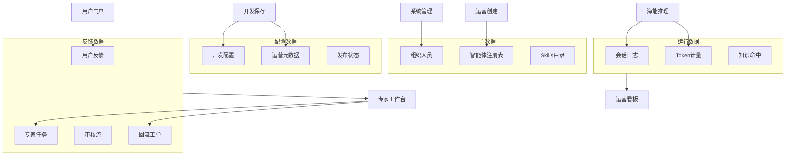

# 04 — 平台关系、数据流与权限串联

**状态**：已定稿（产品层）  
**对应原始需求**：第 3 条「运营管理平台和其他平台的关系、数据流转、权限控制、串联」

---

## 1. 平台关系总表

| 平台/子系统 | 与运营平台关系 | 运营做什么 | 运营不做什么 |
|-------------|----------------|------------|--------------|
| 智能体开发平台 | 镜像协作（同一 agent_id） | 状态/审核/监控摘要；跳转配置 | 直接改提示词/Skills |
| 海能资源服务 | 运行依赖 | 读取消耗/延迟；故障回流 | 调度 GPU |
| 海能推理/知识 API | 能力依赖 | 展示效果与命中摘要 | 改路由策略 |
| 模型服务平台 | 能力上游 | 模型看板、效果反馈 | 执行训练 |
| 知识中心 | 能力上游 | 知识类反馈回流 | 直接编辑库 |
| 系统管理 | 治理底座 | 消费组织/角色；权限工单 | 重复组织主数据 |
| 海能用户门户 | 使用前端 | 收集反馈与行为数据 | 暴露运营后台 |

---

## 2. 双平台五环节（须 API 化）

| # | 协作点 | 触发 | 数据对象 |
|---|--------|------|----------|
| ① | 同步创建 | 运营点创建 | agent 基本信息、owner、scope |
| ② | 获取资源 | 进开发编辑器 | 模型、工具、知识库、Skills（权限过滤） |
| ③ | 同步配置 | 开发保存 | 配置摘要 → 运营详情只读 |
| ④ | 发起对话 | 沙箱/门户 | session、档位、skill overlay |
| ⑤ | 回传指标 | 看板刷新 | 调用量、Token、延迟、失败 |

时序说明：`prototype/02-sequence-create.html`

---

## 3. 数据流四层

### 关键规则

1. **主数据单一来源**：组织→系统管理；agent_id→运营创建为准。  
2. **配置写开发、摘要读运营**：禁止双写（见智能体运营 PRD §1.2）。  
3. **运行数据海能产出、运营消费**：会话结束约 3s 内异步上报。  
4. **反馈数据运营独有**：独立 session key，不写 `proto.js` 业务态（ADR-005）。  
5. **回流工单**：专家完成后生成，指向开发/知识/模型/资源/权限（见 05 文档）。

---

## 4. 权限四层串联

| 层 | 内容 | 系统 |
|----|------|------|
| L1 组织 | 单位/部门/人员、审批链 | 系统管理 |
| L2 角色 | 菜单/功能 | 系统管理 + 运营权限页 |
| L3 应用 | 智能体 scope、Skills 可见性 | 运营+开发 |
| L4 运行时 | 档位、API Key | 海能资源服务 |

---

## 5. 实施阶段（文档层排期）

| 阶段 | 周期 | 产出 |
|------|------|------|
| 1 边界固化 | 1–2 周 | 平台边界清单、agent_id 贯穿、ADR |
| 2 最小串联 | 4–6 周 | 五环节 REST 契约、运营详情只读摘要 |
| 3 闭环串联 | 6–8 周 | 反馈→专家→回流工单；四看板拉通 |
| 4 治理串联 | 持续 | SSO、API Key 与角色联动、审计 |

---

## 6. 与讲稿「问题从哪里来、回到哪里去」

| 用户问题 | 回流目标 |
|----------|----------|
| 回答不准 | 智能体开发（提示词/工作流）或模型微调 |
| 找不到资料 | 知识中心 |
| 响应慢 | 资源服务中心（部署/路由/GPU） |
| 没权限 | 系统管理 |
| 反复出现 | 沉淀为规范、训练任务或知识更新 |

讲稿出处：`平台项目资料/AI中台系统功能介绍与演示讲稿-纯文本.md` §8
