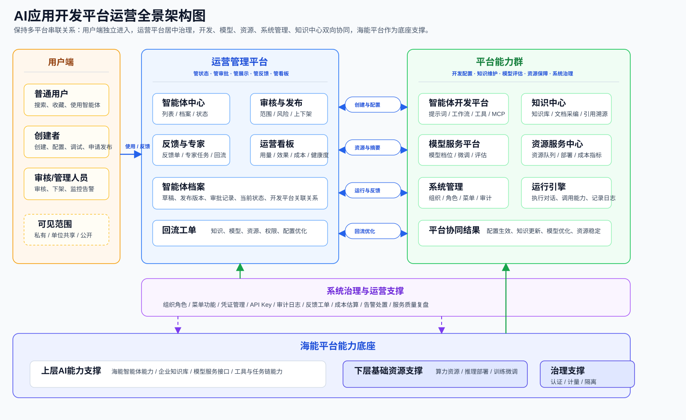

# AI应用开发平台总结性需求报告

> 适用对象：领导评审、业务部门沟通、海能平台协同、后续产品与研发落地。  
> 报告目的：围绕运营全景、角色人力、平台关系、海能对接四类需求，形成一份可阅读、可评审、可继续拆解建设任务的完整报告。  
> 更新时间：2026-06-08

## 一、项目背景与总体定位

AI应用开发平台面向单位内部人工智能应用建设与运营治理，目标不是建设一个单点聊天工具，而是建立一套从应用设计、能力配置、上线发布、用户使用、问题反馈到持续优化的完整平台体系。

平台整体定位可以概括为：以运营管理平台为中枢，以智能体为核心应用对象，串联智能体开发、模型服务、知识中心、资源服务、系统管理和海能平台能力底座，让AI应用具备可建设、可发布、可使用、可运营、可治理、可持续迭代的能力。

从业务视角看，AI应用开发平台承担三类职责：

| 职责 | 说明 |
|---|---|
| 应用建设 | 支持智能体、任务链、工具、MCP服务、知识库、模型档位等能力编排，使AI能力能够快速转化为业务应用 |
| 运营治理 | 管理智能体上架、审核、可见范围、反馈处理、专家任务、运营看板和持续优化，避免AI应用上线后无人治理 |
| 能力串联 | 将海能平台的门户、模型、知识库、智算资源、统一认证和计量能力，与应用开发、业务运营和权限治理连接起来 |

因此，平台建设的重点不是简单汇总菜单，而是围绕AI应用生命周期建立统一机制：前端用户可以稳定使用AI能力，后台人员可以规范建设AI应用，运营团队可以持续发现问题、处理问题并推动优化。

## 二、AI应用开发平台运营全景与模式图

AI应用开发平台的运营全景由六个层面构成：用户入口、运营管理、应用开发、知识与模型服务、海能AI能力底座、系统治理。各层不是孤立存在，而是围绕智能体应用形成上下游关系。

运营全景可以按以下关系理解：

| 层面 | 核心内容 | 与运营平台的关系 |
|---|---|---|
| 用户入口 | 海能门户、智能体入口、通用应用入口、业务应用入口 | 用户使用AI能力并产生行为数据、反馈数据和调用数据 |
| 运营管理 | 智能体运营、发布审核、反馈管理、专家工作台、业务看板、模型看板、资源看板、用户与智能体画像 | 汇聚应用状态、使用效果、问题反馈和治理动作，是平台中枢 |
| 应用开发 | 智能体配置、提示词、任务链、工具、MCP服务、Skills、知识库挂载、模型档位选择 | 负责把AI能力建设成具体业务应用，运营平台读取配置摘要和运行结果 |
| 知识与模型服务 | 知识检索、文档采编、模型训练、微调、评估、版本管理 | 承接知识缺失、模型效果不足等运营反馈 |
| 海能AI能力底座 | 统一门户、通用应用、智能体平台、模型接口、智算训练与推理、企业知识库、统一认证、计量能力 | 提供AI应用运行所需的基础能力 |
| 系统治理 | 组织、角色、菜单、功能、接口、API Key、租户和资源隔离 | 保证不同角色、不同应用、不同模型和知识资源按授权使用 |

运营模式的核心是“建设—使用—反馈—处理—回流”。智能体上线后，用户使用过程产生反馈、调用量、模型效果、知识命中、响应时延等数据；运营平台把这些数据汇聚为看板、反馈单和专家任务；专家判断问题归属后，将优化动作回流到智能体开发、知识中心、模型服务、资源服务或系统管理。

## 三、平台设计理念、核心功能与能力

AI应用开发平台的设计理念包括五点：

| 理念 | 含义 |
|---|---|
| 运营中枢 | AI应用上线后要持续跟踪效果、处理反馈和推动优化，运营管理平台承担统一中枢职责 |
| 智能体为核心对象 | 工具、任务链、知识库、模型、权限和反馈都围绕智能体展开，避免资源与应用割裂 |
| 应用建设与运营治理分工 | 开发平台负责能力配置和调试，运营平台负责状态、审核、反馈、看板和治理 |
| 统一底座、应用扩展 | 海能平台提供统一AI能力底座，AI应用开发平台在业务应用和运营治理层进行功能与范围扩展 |
| 数据驱动持续优化 | 通过使用数据、反馈数据、专家结论和回流工单推动智能体、知识、模型、资源和权限持续优化 |

平台核心能力可划分为七类：

| 能力类别 | 主要能力 |
|---|---|
| 智能体应用建设 | 智能体创建、画像配置、提示词配置、模型档位选择、任务链编排、工具与MCP服务接入、Skills配置、知识库挂载、预览调试、发布申请 |
| 运营管理 | 智能体列表、状态管理、可见范围、发布审核、下架治理、第三方智能体接入、运行摘要、风险提示 |
| 用户反馈与专家处理 | 用户反馈收集、问题分类、专家任务、处理建议、回流工单、处理记录、消息提醒 |
| 运营看板 | 业务看板、模型看板、资源看板、用户与智能体画像，支撑用量、效果、成本、稳定性和问题趋势分析 |
| 知识能力 | 个人知识库、公共知识库、业务知识库、文档上传、文档采编、知识检索、引用溯源、知识更新 |
| 模型与算力能力 | 模型调用、模型训练、微调训练、模型评估、模型部署、推理服务、资源池、队列、存储、镜像、算法、应用发布 |
| 权限与治理 | 组织、人员、角色、菜单、功能、接口、租户、资源隔离、API Key、统一认证、审计和计量 |

这些能力共同支撑一个目标：让业务部门不仅能创建AI应用，还能把AI应用纳入统一运营体系，持续评估效果、发现问题、处理问题、复用能力。

## 四、系统角色与人力规划

AI应用开发平台涉及多类角色，每类角色承担不同职责。

| 角色 | 主要职责 | 典型工作内容 |
|---|---|---|
| 业务用户 | 使用已发布的智能体、知识问答和通用AI应用 | 发起会话、选择可用能力、查看引用来源、提交反馈 |
| 智能体创建者 | 建设和维护具体智能体应用 | 配置画像、提示词、任务链、工具、知识库和模型档位，提交发布 |
| 运营管理员 | 管理应用上架、审核、反馈和运营看板 | 审核发布、巡检运行数据、分派反馈、跟踪处理进度 |
| 领域专家 | 处理专业反馈并给出优化建议 | 判断问题归属，提出知识补充、提示词优化、模型评估或流程调整建议 |
| 知识运营人员 | 维护业务知识资产 | 文档采编、知识更新、问法拓展、知识命中效果复查 |
| 模型与资源维护人员 | 维护模型训练、推理部署和算力资源 | 训练任务、模型评估、资源队列、部署服务、接口调用和成本指标 |
| 平台管理员 | 维护组织、角色、菜单、接口和权限 | 配置组织人员、角色权限、API Key、审计策略和系统参数 |
| 审批人员 | 参与全公司或跨组织范围发布审核 | 审批发布范围、风险提示和上线申请 |

人力规划建议按阶段推进：

| 阶段 | 建议配置 | 建设重点 |
|---|---|---|
| 试点建设阶段 | 产品负责人1人、智能体开发人员2人、运营管理员1人、平台管理员1人 | 打通智能体创建、配置、发布、使用、反馈主流程 |
| 运营闭环阶段 | 增加知识运营1至2人、领域专家池、资源维护人员1人 | 建立反馈处理、专家任务、知识更新、资源巡检和运营看板机制 |
| 能力深化阶段 | 增加模型工程师、数据标注与训练支持人员 | 支撑微调训练、模型评估、专业场景模型优化和成本效果分析 |

在人力安排上，平台不宜只配置开发人员。AI应用上线后的效果依赖知识维护、运营分析、专家判断、资源保障和权限治理。尤其在智能体数量增加后，运营管理员、领域专家和知识运营人员会成为保证平台质量的关键角色。

## 五、运营管理平台与其他平台的关系

运营管理平台是AI应用开发平台的治理与闭环中枢，负责连接各子系统，但不替代各子系统的专业能力。

| 平台或系统 | 主要职责 | 与运营管理平台的关系 |
|---|---|---|
| 智能体开发平台 | 配置智能体、任务链、工具、MCP服务、Skills、知识库和模型档位 | 运营平台管理智能体业务状态和发布治理，开发平台管理底层配置 |
| 海能门户 | 提供用户统一入口和通用AI应用入口 | 用户使用产生的数据和反馈进入运营分析与问题处理 |
| 海能智能体平台 | 提供智能体、任务链、知识库、工具箱、商店、分享和权限角色能力 | AI应用开发平台在运营治理、业务闭环和统一看板层增强 |
| 知识中心 | 管理知识库、文档采编、知识检索和引用溯源 | 运营平台把知识缺失、资料过期、引用不足等问题回流到知识维护 |
| 模型服务平台 | 管理模型训练、微调、评估、版本和模型调用效果 | 运营平台根据模型效果、成本和用户反馈推动模型优化 |
| 资源服务中心 | 管理算力资源、部署服务、队列、镜像、模型文件、API Key和资源指标 | 运营平台根据响应慢、失败率高、资源成本异常等问题发起治理 |
| 系统管理 | 管理组织、人员、角色、菜单、接口和系统参数 | 运营平台使用统一身份和权限体系控制智能体可见范围和操作边界 |

运营管理平台的边界应保持清晰：它负责看状态、管发布、收反馈、看数据、推回流；具体能力配置仍由开发、知识、模型、资源和系统管理各自承接。这样既能形成统一治理，又能避免重复建设和职责混乱。

## 六、数据流转、权限控制与业务串联

AI应用开发平台的数据流可以分为四类：

| 数据类型 | 来源 | 流转方向 | 用途 |
|---|---|---|---|
| 应用主数据 | 智能体创建、应用注册、所有者、可见范围 | 从运营管理进入开发配置和发布流程 | 确认应用是谁创建、谁负责、谁可见、处于什么状态 |
| 配置数据 | 智能体画像、提示词、模型档位、任务链、工具、知识库挂载 | 从开发平台同步摘要到运营管理 | 支撑发布审核、风险判断和问题归因 |
| 运行数据 | 会话日志、调用量、Token、响应时延、失败率、知识命中、模型调用 | 从海能平台、运行时和资源服务汇聚到运营看板 | 支撑业务看板、模型看板、资源看板和用户画像 |
| 反馈数据 | 用户反馈、专家处理、审核意见、回流工单 | 从用户入口进入运营管理，再回流到各能力平台 | 推动知识补充、模型优化、资源调整、权限修正和智能体迭代 |

权限控制应形成四层串联：

| 层级 | 控制内容 | 说明 |
|---|---|---|
| 组织身份层 | 单位、部门、人员、租户、团队 | 确认用户身份和组织归属，是权限控制基础 |
| 角色菜单层 | 角色、菜单、功能、后台入口 | 控制不同角色能进入哪些系统、看到哪些菜单、执行哪些操作 |
| 应用对象层 | 智能体可见范围、知识库可见性、工具可用范围 | 控制用户能使用哪些智能体、知识和能力资源 |
| 运行资源层 | 模型档位、API Key、接口调用、资源配额、计量 | 控制模型、算力、接口和成本相关资源的使用边界 |

业务串联的关键在于把用户问题转化为可处理的运营动作。例如：回答不准确可能回到智能体提示词、知识库或模型服务；找不到资料回到知识中心；响应慢回到资源服务中心；访问范围不合理回到系统管理；某类问题反复出现，则沉淀为智能体优化规范、知识更新任务或模型训练任务。

## 七、AI应用开发平台与海能平台的关系

海能平台提供统一AI能力底座，AI应用开发平台在此基础上承担应用层扩展和运营治理职责。两者关系不是替代关系，而是底座能力与应用运营能力的协同关系。

海能平台能力可概括为八个方面：

| 海能能力 | 内容 | 对AI应用开发平台的支撑 |
|---|---|---|
| 统一门户 | 海能首页、移动云入口、通用应用入口、新门户能力 | 承接业务用户访问和通用AI能力使用 |
| 通用应用 | 智能问答、文档写作、智能会议、智能翻译、PPT助手、问医助手、视频制作 | 为全员办公场景提供成熟AI能力，减少重复建设 |
| 智能体平台 | 智能体、任务链、知识库、工具箱、组件、商店、分享、MCP服务工具 | 为应用建设提供低代码配置、知识挂载和流程编排能力 |
| 知识服务 | 文档上传、文档采编、知识块、问法拓展、知识检索、引用溯源 | 支撑智能体回答的可信来源和知识更新 |
| 模型接口 | 语言模型、DeepSeek、Qwen、GeoGPT、多模态模型、OCR等模型能力 | 支撑智能体对话、内容生成、专业问答和接口调用 |
| 智算训练 | 数据集、标注、数据清洗、数据增强、镜像、算法、训练任务、微调 | 支撑专业模型训练和场景能力增强 |
| 推理部署 | 模型文件、推理后端、部署服务、在线服务、应用发布 | 支撑智能体和业务应用稳定运行 |
| 身份计量 | 统一认证、租户、资源隔离、应用审核、调用量、Token和资源指标 | 支撑权限控制、审计治理和成本管理 |

AI应用开发平台在海能平台基础上扩展四类能力：

1. 应用管理扩展：围绕智能体建立统一注册、状态管理、发布审核、范围管理和下架治理。
2. 运营闭环扩展：围绕用户反馈建立专家处理、问题归因、看板分析和回流工单。
3. 业务治理扩展：围绕部门、角色、应用范围、知识权限、模型档位和API权限建立综合治理。
4. 数据分析扩展：围绕业务使用、模型效果、资源消耗、用户画像和智能体表现形成运营看板。

这种分工能够让海能平台继续沉淀统一AI底座能力，也让AI应用开发平台聚焦业务应用落地和持续运营。

## 八、智能体如何接入海能平台并使用算力

智能体接入海能平台可以按“身份进入、应用配置、能力调用、运行计量、反馈回流”五个环节理解。

| 环节 | 说明 |
|---|---|
| 身份进入 | 用户通过统一身份认证进入海能门户或AI应用入口，平台依据组织、角色和租户信息判断可用应用和能力 |
| 应用配置 | 智能体创建者配置智能体画像、提示词、任务链、工具、知识库和模型档位，形成可运行的AI应用 |
| 能力调用 | 应用运行时根据智能体配置组装上下文，调用海能平台提供的模型接口、知识库接口、工具服务和任务链能力 |
| 算力使用 | 训练、推理和部署所需算力由海能智算平台承接，包括资源池、队列、存储、镜像、算法、训练任务、部署服务和在线服务 |
| 运行计量 | 海能平台提供调用量、Token、时延、失败率、资源使用等指标，运营平台按智能体、部门、模型档位和时间维度汇总分析 |
| 反馈回流 | 用户反馈与运行指标进入运营管理平台，专家判断后回流到智能体配置、知识库、模型训练、资源部署或权限治理 |

算力使用路径可分为训练和推理两类：

| 类型 | 路径 | 说明 |
|---|---|---|
| 模型训练 | 数据集准备 → 数据清洗/增强/标注 → 镜像与算法 → 选择资源队列 → 创建训练任务 → 模型评估 → 版本管理 | 适用于通用模型难以满足专业场景时，通过微调训练提升业务适配能力 |
| 模型推理 | 智能体应用调用 → 模型接口或在线服务 → 推理资源池 → 返回结果 → 计量与日志 | 适用于已发布智能体、知识问答、通用应用和业务应用的在线使用 |

AI应用开发平台不需要直接管理底层GPU节点，而是通过海能智算平台提供的资源池、队列、部署服务和计量指标使用算力。运营管理平台关注的是应用是否稳定、响应是否及时、成本是否合理、资源是否存在瓶颈，以及这些问题如何回到资源服务或模型服务中处理。

## 九、运营闭环与持续优化机制

AI应用的质量不是发布时一次性决定的，而是在持续使用中通过反馈和数据不断优化。运营闭环建议按以下机制运行：

| 机制 | 内容 |
|---|---|
| 上线前治理 | 发布前检查智能体定位、知识来源、模型档位、工具权限、可见范围和风险提示 |
| 使用中监控 | 持续观察调用量、Token、响应时延、失败率、知识命中、用户满意度和反馈类型 |
| 反馈处理 | 用户反馈进入运营平台后，由运营管理员初筛，必要时分派领域专家处理 |
| 专家归因 | 专家判断问题属于智能体配置、知识缺失、模型能力、资源稳定性、权限设置或业务流程 |
| 回流优化 | 根据归因形成优化任务，回到智能体开发、知识中心、模型服务、资源服务或系统管理 |
| 效果复查 | 优化后继续观察使用数据和反馈变化，形成持续迭代 |

运营闭环中最重要的是“问题回到哪里”。如果没有明确回流目标，反馈只是意见收集；如果有明确回流路径，反馈就能变成平台能力提升的入口。

## 十、建设边界、阶段规划与协同事项

### 10.1 建设边界

| 边界 | 说明 |
|---|---|
| 不重复建设海能已有通用应用 | 智能问答、文档写作、智能会议、智能翻译、PPT助手、问医助手、视频制作等能力优先作为海能既有能力接入和展示 |
| 不替代海能智能体平台底层能力 | 智能体、任务链、知识库、工具箱、MCP服务工具等底层构建能力应与海能能力协同 |
| 不直接管理底层GPU节点 | 算力资源由海能智算平台承接，AI应用开发平台关注资源指标、服务稳定性和运营治理 |
| 不绕过统一身份和权限体系 | 用户身份、组织、角色、租户、应用范围、API权限和审计应统一设计 |
| 不让反馈停留在列表 | 用户反馈必须能够进入专家处理和回流优化，否则无法形成运营闭环 |

### 10.2 阶段规划

| 阶段 | 建设目标 | 主要产出 |
|---|---|---|
| 第一阶段：统一口径 | 明确平台定位、海能关系、运营全景、角色人力和平台边界 | 总结性需求报告、运营全景图、角色权限表、协同事项清单 |
| 第二阶段：主流程打通 | 打通智能体创建、配置、发布审核、用户使用、反馈提交 | 智能体生命周期管理、发布审核、用户入口、反馈入口 |
| 第三阶段：运营闭环形成 | 建立反馈分派、专家处理、回流工单和运营看板 | 用户反馈、专家工作台、业务看板、模型看板、资源看板、用户与智能体画像 |
| 第四阶段：能力深化 | 加强知识中心、模型服务、资源服务、系统管理和智能编码伙伴能力 | 知识更新机制、模型评估机制、资源成本治理、权限审计、智能编码能力边界 |
| 第五阶段：持续治理 | 建立质量评估、运营制度、资源成本、模型效果和安全审计机制 | 运营指标体系、服务质量复盘、应用健康度、成本与权限治理报告 |

### 10.3 实施协同事项

为保证平台落地，需要在实施前与海能平台及相关系统统一以下事项：

1. 海能门户与AI应用开发平台入口的呈现方式：统一入口、跳转入口或嵌入入口。
2. 统一身份认证字段、组织租户、角色权限与审批链的映射方式。
3. 模型档位与底层模型能力的映射关系，包括可用范围、配额策略和成本口径。
4. 智能体调用模型接口、知识库接口、任务链和工具服务的技术方式。
5. 训练、推理、部署服务和资源队列的指标口径，包括调用量、Token、时延、失败率和资源使用。
6. 用户反馈与会话日志、知识引用、模型档位、智能体标识之间的关联方式。
7. 第三方智能体接入时的推理路径、接口安全、审核规则和运行计量方式。

## 结语

AI应用开发平台的核心价值，是在海能平台已有AI能力基础上，建立面向业务应用的建设、运营和治理体系。海能平台提供统一门户、通用应用、智能体平台、知识库、模型接口、智算训练与推理、统一认证和计量能力；AI应用开发平台围绕智能体应用，补齐运营全景、发布审核、反馈处理、专家协同、数据看板、权限治理和持续优化机制。

当这套体系建立后，AI应用不再只是单点能力展示，而能够形成从应用建设到用户使用、从问题反馈到专家处理、从数据分析到能力回流的完整闭环，最终支撑单位内部AI应用持续变准、变稳、变好用。
