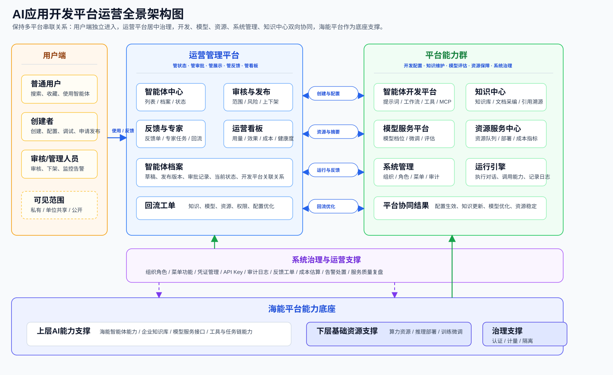
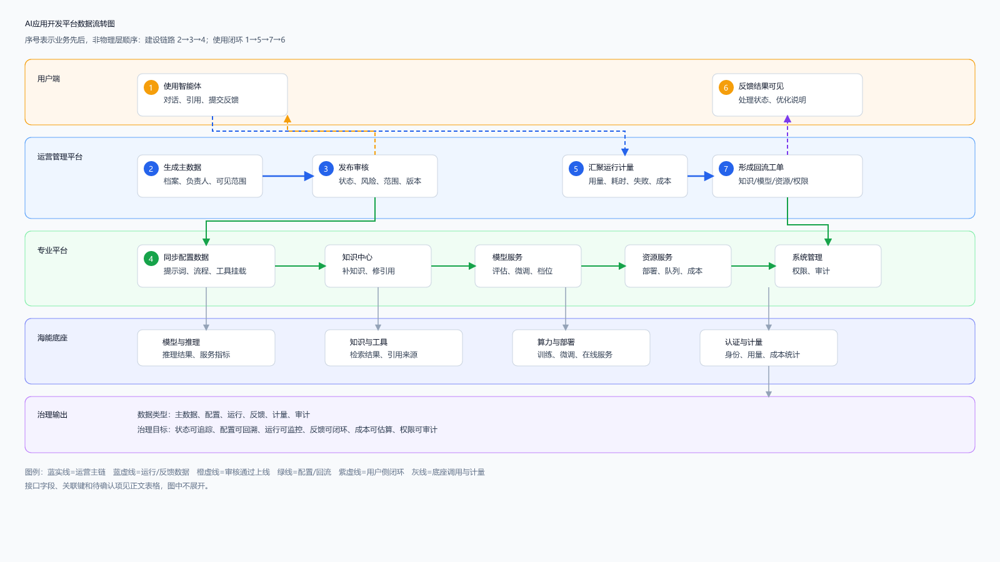
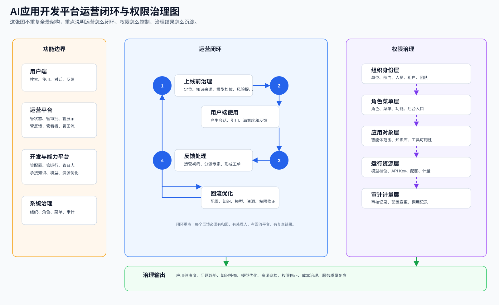

一、项目背景与总体定位

AI应用开发平台面向单位内部人工智能应用建设与运营治理，目标是建立一套从应用设计、能力配置、上线发布、用户使用、问题反馈到持续优化的完整平台体系。

平台整体定位可以概括为：以运营管理平台为中枢，以智能体为核心应用对象，向前承接独立用户端，向后协同智能体开发平台、知识中心、模型服务平台、资源服务中心和系统管理，并由海能平台在底层提供统一认证、模型、知识、推理、训练、算力资源和计量能力。

这里需要明确一个边界：用户使用入口不走海能门户或海能入口，而是通过本平台独立用户端进入。海能平台作为能力底座，不承担本系统的用户入口和运营入口。

从业务视角看，AI应用开发平台承担三类职责：

| 职责 | 说明 |
|---|---|
| 应用建设 | 支持智能体、任务链、工作流、工具、MCP服务、技能、提示词、知识库、模型档位等能力编排，使AI能力能够转化为具体业务应用 |
| 运营治理 | 管理智能体上架、审核、可见范围、反馈处理、专家任务、运行监控、运营看板和持续优化，避免AI应用上线后无人治理 |
| 能力串联 | 通过运营平台把用户端、智能体开发平台、知识中心、模型服务、资源服务、系统管理和海能底座连接起来，形成建设、发布、使用、监控、反馈、优化闭环 |

二、AI应用开发平台运营全景与双向协作模式

AI应用开发平台的全景关系建议按“用户端在前、运营平台居中、专业平台协同、海能底座支撑”理解。运营平台负责管状态、管审批、管展示、管反馈和管看板；智能体开发平台负责配置、调试、运行对接和日志记录；知识中心、模型服务平台、资源服务中心负责承接运营反馈后的专业优化；海能平台在最下层提供算力、模型、推理、训练、统一认证和计量等底层能力。

运营全景可以分为六层：

| 层面 | 核心内容 | 与运营平台的关系 |
|---|---|---|
| 用户端 | 智能体搜索、收藏、使用、对话、引用查看、反馈提交 | 用户端产生使用数据、反馈数据、满意度和问题线索 |
| 运营管理 | 智能体运营、发布审核、可见范围、反馈管理、专家工作台、业务看板、模型看板、资源看板 | 汇聚应用状态、使用效果、问题反馈和治理动作，是平台中枢 |
| 应用开发 | 智能体配置、提示词工程、任务链、工作流、工具、MCP服务、技能、知识库挂载、模型档位选择、预览调试 | 负责把AI能力建设成具体业务应用，并向运营平台同步配置摘要和运行状态 |
| 知识与模型服务 | 知识检索、文档采编、知识库接入、模型训练、微调、评估、版本管理、推理部署 | 承接知识缺失、模型效果不足、成本异常等运营反馈 |
| 资源与系统治理 | 资源队列、部署服务、API Key、凭证、组织、角色、菜单、功能、接口、审计 | 保证不同角色、不同应用、不同模型和知识资源按授权使用 |
| 海能能力底座 | 统一认证、模型接口、知识服务、智算训练、推理部署、资源计量 | 为上层平台提供底层支撑，不作为本系统用户入口 |

运营模式的核心是“建设-发布-使用-监控-反馈-优化”。智能体上线后，用户端产生会话、反馈、知识引用、模型调用、Token、响应时延、失败率等数据；运营平台把这些数据汇聚为看板、反馈单和专家任务；专家或运营人员判断问题归属后，将优化动作回流到智能体开发、知识中心、模型服务、资源服务或系统管理。

典型链路如下：

1. 业务部门提出AI应用诉求，由创建者在运营平台发起智能体创建。
2. 运营平台生成智能体档案，记录名称、类型、负责人、可见范围和初始状态。
3. 运营平台同步创建信息到智能体开发平台，开发平台建立同一个智能体配置对象。
4. 创建者进入智能体开发平台配置提示词、模型档位、知识库、工具、MCP服务、工作流和技能。
5. 开发平台保存配置并同步配置摘要、版本、运行状态到运营平台。
6. 运营平台审核发布范围、风险提示、能力说明和展示信息。
7. 审核通过后，智能体在用户端展示并提供使用。
8. 用户端对话时由智能体运行引擎执行实际调用，运行过程调用海能底座的模型、知识、推理和计量能力。
9. 运行日志、用量、耗时、失败率、Token、费用估算和反馈进入运营平台看板。
10. 运营平台根据反馈和指标形成优化任务，回流到开发、知识、模型、资源或系统管理侧。

三、平台设计理念、核心功能与能力

AI应用开发平台的设计理念包括五点：

| 理念 | 含义 |
|---|---|
| 运营中枢 | AI应用上线后要持续跟踪效果、处理反馈和推动优化，运营管理平台承担统一中枢职责 |
| 智能体为核心对象 | 工具、任务链、知识库、模型、权限、日志和反馈都围绕智能体展开，避免资源与应用割裂 |
| 应用建设与运营治理分工 | 开发平台负责配置、预览、调试和运行对接，运营平台负责状态、审核、展示、反馈、看板和治理 |
| 海能底座、上层扩展 | 海能平台提供底层AI能力，本平台在用户端、应用建设、运营治理和闭环优化层进行扩展 |
| 数据驱动持续优化 | 通过使用数据、反馈数据、专家结论、计量数据和回流工单推动智能体、知识、模型、资源和权限持续优化 |

平台核心能力可划分为八类：

| 能力类别 | 主要能力 |
|---|---|
| 用户端使用能力 | 智能体搜索、分类、收藏、最近使用、对话、引用查看、文件结果、反馈提交 |
| 智能体应用建设 | 智能体创建、提示词配置、模型档位选择、任务链编排、工作流配置、工具与MCP服务接入、技能配置、知识库挂载、预览调试、发布申请 |
| 能力与组件管理 | 能力网关、组件中心、智能体组件、工作流节点、工具、MCP服务、技能管理 |
| 提示词工程 | 提示词模板、提示词框架、提示词调试、提示词版本管理、适用场景说明 |
| 运营管理 | 智能体列表、状态管理、可见范围、发布审核、下架治理、第三方智能体接入、运行摘要、风险提示 |
| 用户反馈与专家处理 | 用户反馈收集、问题分类、专家任务、处理建议、回流工单、处理记录、消息提醒 |
| 运营看板 | 业务看板、模型看板、资源看板、用户与智能体画像，支撑用量、效果、成本、稳定性和问题趋势分析 |
| 权限、凭证与监控治理 | 组织、人员、角色、菜单、功能、接口、租户、资源隔离、凭证管理、API Key、系统监控、Token统计、审计和计量 |

四、未来运营组织与人力规划

人力规划建议和阶段规划放在一起理解：平台不是上线后只靠开发维护，而是要逐步形成运营、知识、专家、模型资源、数据分析和安全审计的协同机制。人数不是固定编制，而是随智能体数量、用户规模、反馈量和模型资源成本逐步扩展。

| 阶段 | 建议人数 | 角色配置 | 主要工作 | 触发扩编条件 |
|---|---:|---|---|---|
| 试点建设期 | 约5人 | 产品负责人1人、运营管理员1人、智能体配置/开发2人、平台管理员1人 | 打通创建、配置、发布、使用、反馈主流程；形成首批智能体样板；梳理基础权限和发布规则 | 试点智能体超过10个，或日常反馈需要固定人员跟进 |
| 运营闭环期 | 约8-12人 | 产品/运营2人、智能体配置3-4人、知识运营1-2人、领域专家池、模型资源维护1人、平台管理员1人 | 建立反馈分派、专家处理、知识更新、资源巡检、看板复盘和版本回流机制 | 智能体超过30个，或跨部门发布、知识维护、模型效果问题明显增加 |
| 规模化运营期 | 约12-20人 | 运营负责人1人、运营管理员2-3人、智能体配置/开发4-6人、知识运营2-3人、模型评估/资源维护2人、数据分析1-2人、安全审计1人、领域专家池 | 支撑多部门应用管理、成本治理、模型效果评估、审计合规、SLA复盘和平台运营制度 | 智能体超过50个，用户覆盖多个部门，Token费用、模型效果和权限审计成为常态管理事项 |

各类人员的职责建议如下：

| 人员类型 | 人数建议 | 负责事项 |
|---|---:|---|
| 产品负责人 | 1人 | 统一平台目标、需求优先级、跨平台协同事项和评审口径 |
| 运营管理员 | 1-3人 | 智能体状态管理、发布审核、反馈初筛、运营看板复盘、下架治理 |
| 智能体配置/开发人员 | 2-6人 | 提示词、工作流、工具、MCP、技能、模型档位、知识库挂载和调试 |
| 知识运营人员 | 1-3人 | 文档采编、知识库维护、问法拓展、引用溯源复查、知识过期治理 |
| 领域专家 | 专家池 | 判断业务问题归因，给出专业修正建议，参与高风险应用审核 |
| 模型与资源维护人员 | 1-2人 | 模型评估、推理服务、资源队列、训练任务、调用失败和成本异常处理 |
| 数据分析人员 | 0-2人 | 用户行为、调用量、Token、反馈趋势、应用健康度和费用估算分析 |
| 平台管理员 | 1人 | 组织、角色、菜单、接口、凭证、API Key和系统参数维护 |
| 安全与审计人员 | 0-1人 | 第三方智能体接入、敏感数据、接口调用、权限变更和审计日志复查 |

五、数据流转、接口规范与治理要求

数据部分建议按六类管理：主数据、配置数据、运行数据、反馈数据、计量数据、审计数据。每类数据都要明确产生方、消费方、同步方式、接口形态、关键字段和治理规范，避免平台之间只看页面、不知道数据从哪里来、到哪里去、以什么口径统计。

数据分类建议如下：

| 数据类型 | 产生方 | 消费方 | 流向 | 同步方式 | 接口形态 | 关键字段 | 更新频率 | 治理规范 |
|---|---|---|---|---|---|---|---|---|
| 主数据 | 运营管理平台 | 智能体开发平台、用户端、系统管理 | 运营平台创建后同步到开发平台和用户端 | 实时同步 | REST/JSON | `agent_id`、`agent_name`、`owner_id`、`org_id`、`visibility_scope`、`status` | 创建、修改、上下架时 | `agent_id` 全局唯一；状态变更必须留痕 |
| 配置数据 | 智能体开发平台 | 运营管理平台、运行引擎 | 开发平台保存后同步摘要到运营平台，完整配置供运行引擎使用 | 实时或保存后同步 | REST/JSON | `agent_id`、`config_version`、`prompt_id`、`workflow_id`、`tool_ids`、`knowledge_base_id`、`model_tier` | 保存配置、发布版本时 | 运营平台只保存摘要和风险信息，不替代开发平台管理完整配置 |
| 运行数据 | 智能体运行引擎、海能底座 | 运营管理平台、模型服务、资源服务 | 运行结束或阶段性上报到运营平台 | 事件上报或消息队列 | Event/JSON | `session_id`、`trace_id`、`agent_id`、`user_id`、`model_tier`、`latency_ms`、`success`、`error_code` | 每次调用或批量上报 | 运行日志需支持按智能体、用户、时间、模型档位追踪 |
| 反馈数据 | 用户端、运营管理平台、专家工作台 | 运营管理平台、知识中心、模型服务、开发平台 | 用户提交后进入运营平台，处理后回流到对应平台 | 实时提交，处理过程状态流转 | REST/JSON + Event/JSON | `feedback_id`、`session_id`、`agent_id`、`user_id`、`feedback_type`、`priority`、`owner_platform`、`work_order_id` | 提交、分派、处理、关闭时 | 反馈必须关联会话、智能体和处理结果，避免只留文字意见 |
| 计量数据 | 海能底座、运行引擎、资源服务中心 | 运营管理平台、资源服务、财务或成本治理 | 从底层计量汇聚到运营看板和资源看板 | 定时汇总或事件上报 | Meter API/JSON，字段 `待确认` | `agent_id`、`tenant_id`、`model_tier`、`token_input`、`token_output`、`cost_estimate`、`duration_ms` | 每次调用、小时级或天级汇总 | Token、费用、耗时、失败率统计口径需和海能统一 |
| 审计数据 | 系统管理、运营管理、开发平台 | 系统管理、安全审计、运营管理 | 权限变更、发布审核、配置变更、接口调用记录进入审计 | 实时写入 | Audit Log/JSON | `audit_id`、`operator_id`、`action`、`target_type`、`target_id`、`before`、`after`、`ip`、`time` | 每次关键操作 | 涉及发布、下架、权限、API Key、第三方接入必须留审计 |

接口与协议建议口径如下：

| 场景 | 建议接口或协议 | 说明 |
|---|---|---|
| 后台管理类接口 | REST/JSON | 适合智能体主数据、发布审核、可见范围、菜单权限、配置摘要同步 |
| 运行事件、反馈事件、计量事件 | Event/JSON 或消息队列 | 适合会话结束、调用失败、Token统计、反馈分派、工单关闭等事件 |
| 知识文档、模型文件、大附件 | 文件服务或对象存储 | 文档、模型文件、附件不建议直接放在业务接口中传输 |
| 统一身份认证 | SSO/OIDC 或既有 IAM 对接 | 具体令牌字段、租户字段、组织字段、角色字段标 `待确认` |
| 海能模型、推理、训练和计量 | 海能 API 网关或平台接口 | API Base URL、鉴权方式、模型档位映射、Meter字段标 `待确认` |

当前 `prototype` 页面和平台 API 演示契约只作为 `原型` 与 `mock` 依据，用于说明流程、数据口径和交互关系，不代表真实后端接口已经完成。正式落地时，接口地址、鉴权方式、字段枚举、错误码、计量口径和审计日志格式仍需与海能平台及相关系统统一确认。

统一关联键建议如下：

| 字段 | 用途 |
|---|---|
| `agent_id` | 串联运营平台、开发平台、运行引擎、反馈、计量和审计的智能体唯一标识 |
| `user_id` | 识别用户端使用者、反馈提交人、操作人 |
| `tenant_id` | 区分租户或单位范围 |
| `org_id` | 区分组织、部门和管理范围 |
| `model_tier` | 记录用户可见模型档位，底层真实模型映射 `待确认` |
| `session_id` | 串联一次用户对话和反馈上下文 |
| `trace_id` | 串联一次运行过程中的模型、知识、工具、资源调用链 |
| `feedback_id` | 串联反馈、专家处理、回流工单和关闭结果 |
| `knowledge_base_id` | 串联知识库挂载、知识命中、引用溯源和知识更新 |
| `work_order_id` | 串联运营平台分派给开发、知识、模型、资源或系统管理的优化任务 |

六、权限控制、功能边界与业务串联

权限控制建议按五层串联：组织身份层、角色菜单层、应用对象层、运行资源层、审计计量层。前四层控制“谁能看、谁能用、谁能改、能用多少”，审计计量层负责记录和追踪。

| 层级 | 控制内容 | 说明 |
|---|---|---|
| 组织身份层 | 单位、部门、人员、租户、团队 | 确认用户身份和组织归属，是权限控制基础 |
| 角色菜单层 | 角色、菜单、功能、后台入口 | 控制不同角色能进入哪些系统、看到哪些菜单、执行哪些操作 |
| 应用对象层 | 智能体可见范围、知识库可见性、工具可用范围 | 控制用户能使用哪些智能体、知识和能力资源 |
| 运行资源层 | 模型档位、API Key、接口调用、资源配额、计量 | 控制模型、算力、接口和成本相关资源的使用边界 |
| 审计计量层 | 审核记录、配置变更、调用记录、Token、费用估算 | 支撑安全审计、成本治理和问题追踪 |

运营平台和开发平台的功能边界可结合上图理解：运营平台负责状态、审批、展示、反馈和看板，开发平台负责配置、调试、运行对接和开发日志；知识、模型、资源、系统管理承接运营平台回流的专业优化任务。

业务串联的关键在于把用户问题转化为可处理的运营动作。用户在使用智能体和模型对话的过程中，如果反馈回答不准确、知识找不到、流程有问题、响应时间长等问题，专家工作台可以对问题进行分类和判断：

1. 如果是智能体配置问题，回到智能体开发平台优化提示词、工作流、工具或MCP服务。
2. 如果是知识缺失，回到知识中心补充或更新知识库。
3. 如果是模型能力不足，回到模型服务平台整理数据、做微调、评估或切换模型档位。
4. 如果是资源或响应问题，回到资源服务中心检查部署、队列、推理服务和算力情况。
5. 如果是访问范围和权限问题，回到系统管理调整角色、菜单、功能和接口权限。

七、AI应用开发平台与海能平台的关系

海能平台提供统一AI能力底座，AI应用开发平台在此基础上承担用户端、应用层扩展和运营治理职责。两者关系不是入口替代关系，而是底座能力与应用运营能力的协同关系。

海能平台能力可概括为六个方面：

| 海能能力 | 内容 | 对AI应用开发平台的支撑 |
|---|---|---|
| 统一认证与租户 | 统一身份、租户、组织、角色基础信息 | 支撑用户识别、组织权限、审计追踪；具体SSO字段 `待确认` |
| 模型接口 | 语言模型、专业模型、多模态模型、OCR等模型能力 | 支撑智能体对话、内容生成、专业问答和接口调用；模型档位映射 `待确认` |
| 知识服务 | 文档上传、文档采编、知识块、问法拓展、知识检索、引用溯源 | 支撑智能体回答的可信来源和知识更新；知识库字段 `待确认` |
| 智算训练 | 数据集、标注、数据清洗、数据增强、镜像、算法、训练任务、微调 | 支撑专业模型训练和场景能力增强；资源队列策略 `待确认` |
| 推理部署 | 模型文件、推理后端、部署服务、在线服务、应用发布 | 支撑智能体和业务应用稳定运行；推理接口与服务指标 `待确认` |
| 计量与资源指标 | 调用量、Token、时延、失败率、资源使用、成本估算 | 支撑运营看板、成本治理和资源治理；Meter字段 `待确认` |

AI应用开发平台在海能平台基础上扩展四类能力：

1. 用户端扩展：提供独立用户端，承接智能体搜索、使用、对话、引用查看和反馈提交。
2. 应用管理扩展：围绕智能体建立统一注册、状态管理、发布审核、范围管理和下架治理。
3. 运营闭环扩展：围绕用户反馈建立专家处理、问题归因、看板分析和回流工单。
4. 数据治理扩展：围绕业务使用、模型效果、资源消耗、权限审计、用户行为和智能体表现形成运营看板。

这种分工能够让海能平台继续沉淀统一AI底座能力，也让AI应用开发平台聚焦用户使用、业务应用落地和持续运营。

八、接入海能平台算力资源

智能体接入海能平台可以按“身份确认、应用配置、能力调用、算力使用、运行计量、反馈回流”六个环节理解。

| 环节 | 说明 |
|---|---|
| 身份确认 | 用户通过本平台用户端进入，底层可对接海能统一认证或既有IAM能力；SSO令牌字段、租户字段、组织字段、角色字段 `待确认` |
| 应用配置 | 创建者配置智能体、提示词、任务链、工具、知识库和模型档位，形成可运行的AI应用 |
| 能力调用 | 应用运行时根据智能体配置组装上下文，调用海能平台提供的模型接口、知识库接口、工具服务和任务链能力；API契约 `待确认` |
| 算力使用 | 训练、推理和部署所需算力由海能智算平台承接，包括资源池、队列、存储、镜像、算法、训练任务、部署服务和在线服务；资源队列策略 `待确认` |
| 运行计量 | 海能平台提供调用量、Token、时延、失败率、资源使用等指标，运营平台按智能体、部门、模型档位和时间维度汇总分析；Meter字段 `待确认` |
| 反馈回流 | 用户反馈与运行指标进入运营管理平台，专家判断后回流到智能体配置、知识库、模型训练、资源部署或权限治理 |

算力使用路径可分为训练和推理两类：

| 类型 | 路径 | 说明 |
|---|---|---|
| 模型训练 | 数据集准备 -> 数据清洗/增强/标注 -> 镜像与算法 -> 选择资源队列 -> 创建训练任务 -> 模型评估 -> 版本管理 | 适用于通用模型难以满足专业场景时，通过微调训练提升业务适配能力 |
| 模型推理 | 用户端发起对话 -> 智能体运行引擎组装上下文 -> 调用模型接口或在线服务 -> 推理资源池返回结果 -> 计量与日志上报 | 适用于已发布智能体、知识问答、通用应用和业务应用的在线使用 |

AI应用开发平台不需要直接管理底层GPU节点，而是通过海能智算平台提供的资源池、队列、部署服务和计量指标使用算力。运营管理平台关注的是应用是否稳定、响应是否及时、成本是否合理、资源是否存在瓶颈，以及这些问题如何回到资源服务或模型服务中处理。

九、运营闭环与持续优化机制

AI应用的质量是在持续使用中通过反馈和数据不断优化。运营闭环按以下机制运行：

| 机制 | 内容 |
|---|---|
| 上线前治理 | 发布前检查智能体定位、知识来源、模型档位、工具权限、可见范围和风险提示 |
| 使用中监控 | 持续观察调用量、Token、响应时延、失败率、知识命中、用户满意度和反馈类型 |
| 反馈处理 | 用户反馈进入运营平台后，由运营管理员初筛，必要时分派领域专家处理 |
| 专家归因 | 专家判断问题属于智能体配置、知识缺失、模型能力、资源稳定性、权限设置或业务流程 |
| 回流优化 | 根据归因形成优化任务，回到智能体开发、知识中心、模型服务、资源服务或系统管理 |
| 效果复查 | 优化后继续观察使用数据和反馈变化，形成持续迭代 |

运营闭环中最重要的是“问题回到哪里”。如果没有明确回流目标，反馈只是意见收集；如果有明确回流路径，反馈就能变成平台能力提升的入口。

十、建设阶段与协同事项

阶段规划与人力规划应配套推进：

| 阶段 | 建设目标 | 主要产出 | 对应人力重点 |
|---|---|---|---|
| 第一阶段：统一口径 | 明确平台定位、海能关系、运营全景、角色人力和平台边界 | 总结性需求报告、运营全景图、角色权限表、协同事项清单 | 约5人，完成试点样板和主流程 |
| 第二阶段：主流程打通 | 打通智能体创建、配置、发布审核、用户端使用、反馈提交 | 智能体生命周期管理、发布审核、用户端入口、反馈入口 | 约5-8人，补充运营和配置支持 |
| 第三阶段：运营闭环形成 | 建立反馈分派、专家处理、回流工单和运营看板 | 用户反馈、专家工作台、业务看板、模型看板、资源看板 | 约8-12人，增加知识运营和专家池 |
| 第四阶段：能力深化 | 加强知识中心、模型服务、资源服务、系统管理能力 | 知识更新机制、模型评估机制、资源成本治理、权限审计 | 约12人以上，增加模型资源和数据分析支持 |
| 第五阶段：持续治理 | 建立质量评估、运营制度、资源成本、模型效果和安全审计机制 | 运营指标体系、服务质量复盘、应用健康度、成本与权限治理报告 | 约12-20人，形成规模化运营组织 |

为保证平台落地，需要在实施前与海能平台及相关系统统一以下事项：

1. 用户端与统一认证的对接方式，以及是否复用海能SSO或既有IAM能力。
2. 统一身份认证字段、组织租户、角色权限与审批链的映射方式。
3. 模型档位与底层模型能力的映射关系，包括可用范围、配额策略和成本口径。
4. 智能体调用模型接口、知识库接口、任务链和工具服务的技术方式。
5. 训练、推理、部署服务和资源队列的指标口径，包括调用量、Token、时延、失败率和资源使用。
6. 用户反馈与会话日志、知识引用、模型档位、智能体标识之间的关联方式。
7. 第三方智能体接入时的推理路径、接口安全、审核规则和运行计量方式。

总结

AI应用开发平台的核心价值，是在海能平台已有AI能力基础上，建立面向业务应用的建设、运营和治理体系。海能平台在底层提供统一认证、模型接口、知识服务、智算训练、推理部署、资源计量等能力；AI应用开发平台在上层提供独立用户端、智能体应用建设、发布审核、反馈处理、专家协同、运营看板、权限治理和持续优化机制。

当这套体系建立后，AI应用不再只是单点能力展示，而能够形成从应用建设到用户端使用、从问题反馈到专家处理、从数据分析到能力回流的完整闭环，最终支撑单位内部AI应用持续变准、变稳、变好用。
