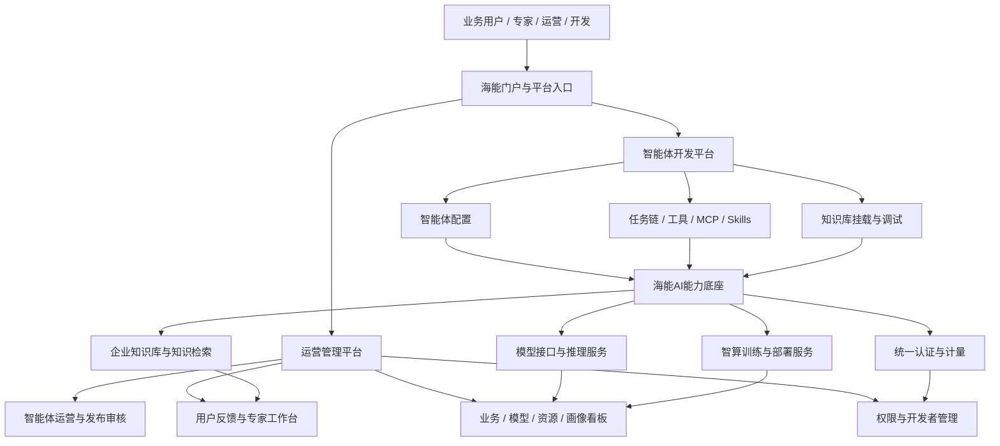
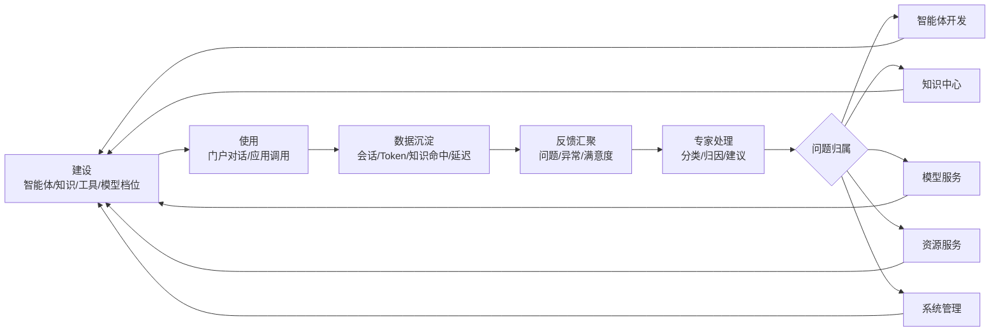
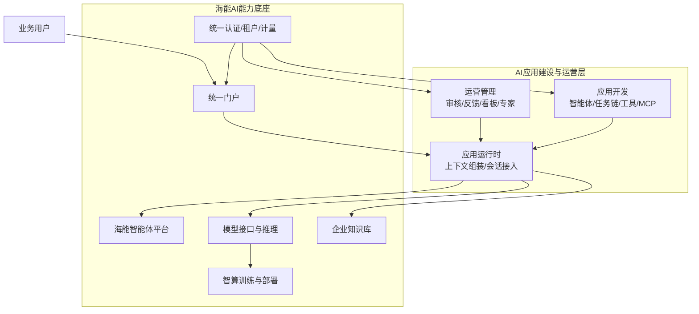
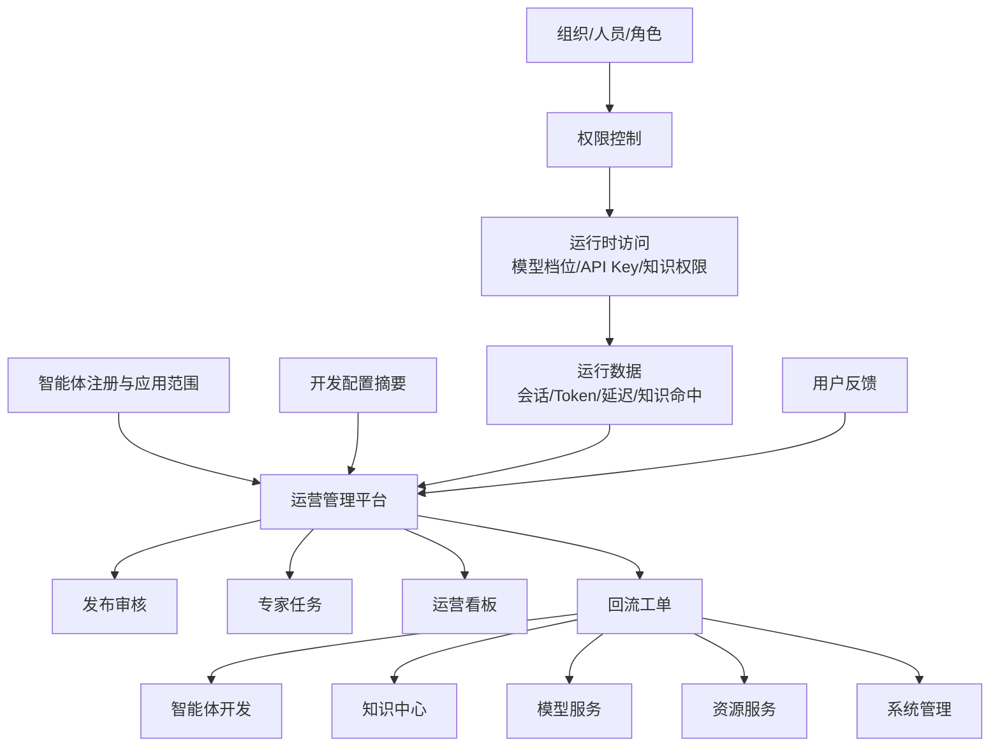

# 图表源码附录

> 本附录用于在飞书文档或其他支持 Mermaid 的工具中手动渲染和修改图表。正式报告正文见 `06-AI应用开发平台总结性需求报告.md`。

## 1. 平台全景图

源码文件：`assets/platform-panorama.mmd`

## 2. 运营闭环图

源码文件：`assets/ops-loop.mmd`

## 3. 海能分层关系图

源码文件：`assets/haineng-integration.mmd`

## 4. 数据权限串联图

源码文件：`assets/data-permission-flow.mmd`

