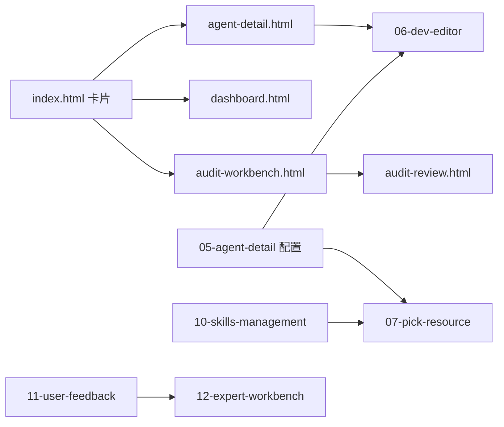

# 原型页面索引（35 页根目录 + 7 页 Web 用户端）

> 与 `平台项目资料/演示页面路由表.md` 对照使用。最后更新：2026-06-11（v1.1 扁平化为默认入口）。

## 页面清单

### 架构与文档

| 文件 | 说明 | 类型 |
|------|------|------|
| `01-architecture.html` | 双平台架构图 + 敖钦基座 | 文档 |
| `02-sequence-create.html` | 创建流程时序图 | 文档 |
| `docs/agent-ops-flow.html` | 智能体运营全生命周期流程文档 | 文档 |

### 智能体运营 v1.1（默认入口，根目录扁平化）

| 文件 | 说明 | 类型 |
|------|------|------|
| `index.html` | **运营平台默认首页** — 卡片列表、创建/第三方接入 | **主入口** |
| `dashboard.html` | 运营概览 / KPI | 运营 |
| `audit-workbench.html` | 审核工作台 | 审核 |
| `audit-review.html` | 审核详情 | 审核 |
| `agent-detail.html` | 运营视角详情（点卡片进入） | 运营 |
| `assets/ops-v11-app.js` | v1.1 卡片/审核/生命周期逻辑 | 脚本 |
| `assets/ops-v11.css` | v1.1 页面样式 | 样式 |

### 配置与开发（保留）

| 文件 | 说明 | 类型 |
|------|------|------|
| `04-create-modal.html` | 创建智能体 / 首次配置入口 | 流程 |
| `05-agent-detail.html` | **配置视角**详情（Tab、Skills、发布、monitor） | **核心** |
| `08-audit-expert.html` | 专家任务审核 | 审核 |
| `third-party-register.html` | 第三方智能体接入 | 流程 |

### 用户反馈 + 专家闭环

| 文件 | 说明 | 类型 |
|------|------|------|
| `11-user-feedback.html` | 用户反馈列表 + 趋势 | 运营 |
| `11-user-feedback-detail.html` | 反馈详情、分派、处理弹窗 | 运营 |
| `12-expert-workbench.html` | 专家工作台（我的任务 / 任务池） | 运营 |
| `12-expert-task-detail.html` | 专家任务详情 | 运营 |
| `12-expert-task-view.html` | 专家任务只读视图 | 运营 |
| `12-expert-context.html` | 做任务 / 上下文分析 | 运营 |

### 运营看板四件套

| 文件 | 说明 | 类型 |
|------|------|------|
| `14-business-dashboard.html` | 业务看板 + 回流工单 | 看板 |
| `14-model-dashboard.html` | 模型看板（档位分布） | 看板 |
| `14-resource-dashboard.html` | 资源看板（Token/GPU） | 看板 |
| `14-user-agent-profile.html` | 用户与智能体画像 | 看板 |

### 权限与组织

| 文件 | 说明 | 类型 |
|------|------|------|
| `13-permission-mgmt.html` | 权限与开发者管理 | 管理 |
| `13-permission-add.html` | 新增开发者 | 管理 |
| `13-permission-edit.html` | 编辑开发者 | 管理 |
| `13-permission-view.html` | 开发者只读 | 管理 |
| `13-org-structure.html` | 组织架构 | 管理 |

### 智能体开发

| 文件 | 说明 | 类型 |
|------|------|------|
| `06-dev-platform.html` | 开发平台列表 | 开发 |
| `06-dev-editor.html` | 三列编排编辑器 | 开发 |
| `06-dev-resources.html` | 开发资源管理 | 开发 |
| `07-pick-resource.html` | 资源 / Skill 选择 | 流程 |
| `10-skills-management.html` | Skills 管理表格 | 开发 |

### 用户门户

| 文件 | 说明 | 类型 |
|------|------|------|
| `09-user-chat.html` | 敖钦用户对话门户（极简旧入口，跳转 web端） | 用户端 |
| `web端/login.html` | **企业邮箱登录**（mock 认证、忘记密码入口） | 用户端门禁 |
| `web端/forgot-password.html` | 忘记密码（验证码 mock → 重置） | 用户端门禁 |
| `web端/index.html` | **Web 用户端首页**（默认对话、模型选择、反馈闭环） | **用户端主入口** |
| `web端/agent-square.html` | **智能体广场**（推荐 / 全部 / 我的、分类、收藏、立即使用） | 用户端二级页 |
| `web端/my-space.html` | **我的空间**（基础信息、个人笔记、个人智能体、收藏 / 最近使用） | 用户端资产中心 |
| `web端/专家工作台/workbench.html` | 用户端专家工作台 | 用户端 |
| `web端/专家工作台/task-detail.html` | 用户端专家做任务 | 用户端 |
| `web端/专家工作台/task-view.html` | 用户端任务只读 | 用户端 |
| `web端/专家工作台/context.html` | 用户端查看上下文 | 用户端 |

### 重定向 / 设计交付

| 文件 | 说明 | 类型 |
|------|------|------|
| `03-agent-center.html` | 重定向 → `index.html` | 重定向 |
| `08-agent-monitor.html` | 重定向 → 05 `?tab=monitor` | 重定向 |
| `08-audit-queue.html` | 重定向 → `旧页面/08-audit-queue.html` | 重定向 |
| `08-audit-review.html` | 重定向 → `旧页面/08-audit-review.html` | 重定向 |
| `08-audit-status.html` | 重定向 → `旧页面/08-audit-status.html` | 重定向 |
| `figma-skills-board.html` | Figma 5 屏合成板（宽画布） | 设计交付 |

### 旧页面归档（`旧页面/`）

| 文件 | 说明 |
|------|------|
| `旧页面/index-v1.0.html` | v1.0 表格列表 + 内嵌看板 + 完整新建/第三方弹窗 |
| `旧页面/04-create-modal.html` | 新建智能体独立页 |
| `旧页面/third-party-register.html` | 第三方接入独立页 |
| `旧页面/08-audit-*.html` | v1.0 审核链三页 |

侧栏 **智能体运营 → 旧版页面归档** 可直达 `旧页面/index-v1.0.html`。

---

## 侧栏占位（尚无独立页）

| 菜单 | 状态 |
|------|------|
| 模型运营 | `#` 占位 |
| 资源与成本管理 | `#` 占位 |
| 帮助文档 | `#` 占位 |

---

## 主路径导航

---

## 状态说明

- 运营 v1.1 状态：`assets/ops-v11-app.js` → `proto_ops_v11_agents_v4`
- 配置/Skills：`assets/proto.js` + sessionStorage
- 五环节 mock：`assets/platform-api.js`；反馈闭环：`ops-feedback-loop.js`
- Demo 智能体：`agt_demo_001`（客服助手）

## Spot-check（2 分钟）

1. `index.html` → 点卡片 → `agent-detail.html` → 返回 index → 再进  
2. `05-agent-detail.html?id=agt_demo_001` — Skills ≥1，`+` 弹窗，Tab 可切换；回 index 再进 05 一致  
3. `10-skills-management.html` — ≥ 6 条 Skill  

详见 [DELIVERY-CHECKLIST.md](../DELIVERY-CHECKLIST.md)。
