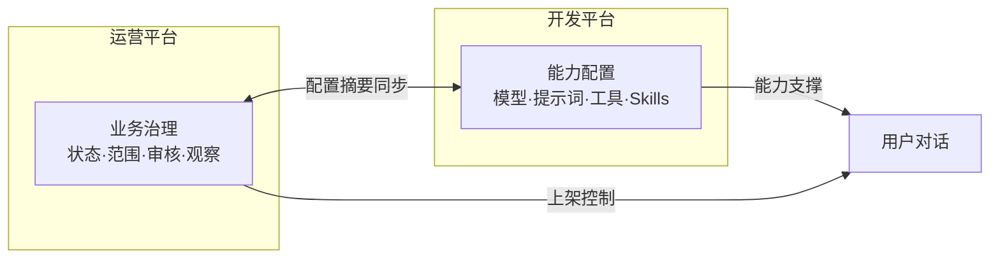
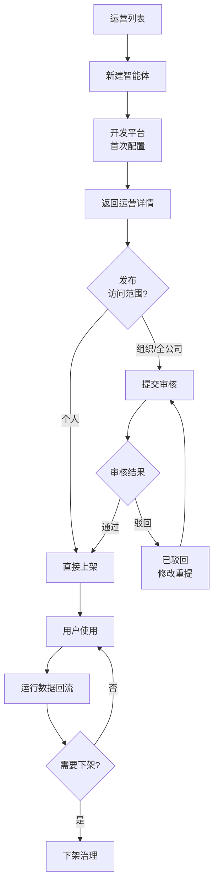
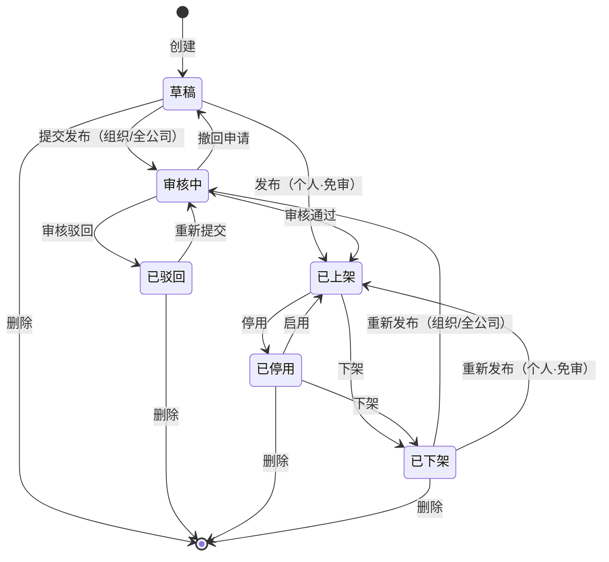
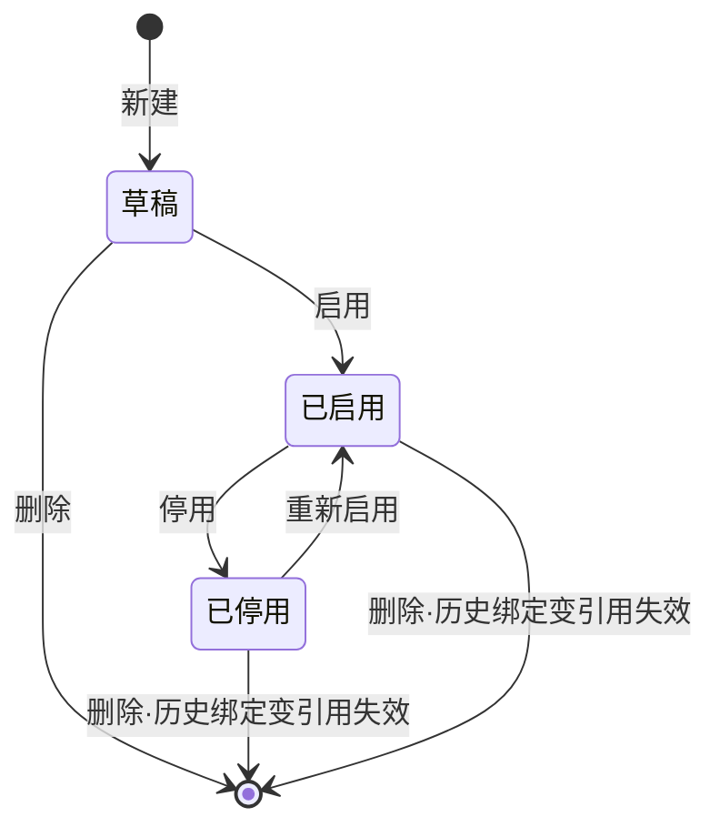
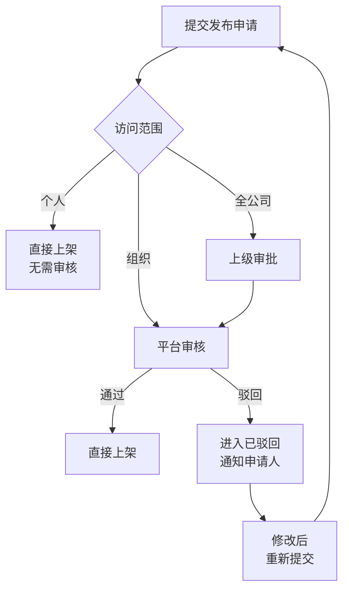

# 智能体运营 · 产品需求文档 v2.0

> **版本说明**：基于 v1.0 迭代。主要变更：① 智能体状态体系统一为 6 态；② 发布/审核规则明确（访问范围决定路径）；③ 访问范围术语统一（个人/组织/全公司）；④ 卡片操作矩阵规范化；⑤ Mermaid 图替换全部飞书内嵌图；⑥ 全部"待确认"项落地。详见末尾**版本变更说明**。

---

## （1）产品定位与范围

### 1.1 模块定位

智能体运营是运营平台下的智能体治理模块，负责智能体从创建、配置引导、发布审核、运行观察到下架治理的业务闭环。该模块不直接承载模型推理、工具执行、知识检索等底层运行能力，而是围绕智能体这个业务对象提供状态管理、访问范围管理、审核治理和运行数据观察。

在用户心智上，运营平台回答"这个智能体能不能上架、谁能使用、运行效果如何"；智能体开发平台回答"这个智能体具体如何工作、引用哪些能力资源"。

### 1.2 双平台职责

| 平台 | 职责 |
|------|------|
| 运营平台 | 管理智能体业务状态、来源、访问范围、发布审核、运行观察、下架治理 |
| 智能体开发平台 | 管理智能体画像、模型、提示词、变量、工具、MCP、工作流、知识库、Skills 等运行能力 |

运营平台可以展示开发平台同步过来的配置摘要，但不直接修改底层运行配置。涉及模型、提示词、工具、工作流、知识库、Skills 等能力配置时，跳转到开发平台完成。

### 1.3 资源从属原则

Agent 是运营与配置的核心对象。工具、MCP、工作流、知识库、Skills 都是智能体的从属能力资源，应围绕具体智能体被引用、配置和治理。

运营平台不维护独立资源中心，也不提供资源创建、编辑、绑定入口。运营侧只保留必要的资源摘要、风险提示和跳转入口。

### 1.4 Skills 定位

Skills 是一种轻量能力资源，用于沉淀可复用的任务方法、表达规范、推理步骤和输出结构。它不是工具调用，也不是知识库检索，而是作为"方法型指令资源"注入智能体运行上下文。

| 场景 | 产品规则 |
|------|---------|
| Skill 资源维护 | 在开发平台完成创建、导入、编辑、启停、删除、可见范围维护 |
| 智能体长期绑定 | 在开发平台智能体配置中完成，保存后成为该智能体默认运行能力 |
| 用户临时使用 | 在用户对话过程中临时选择，只影响当前会话，不回写智能体长期配置 |
| 运营详情查看 | 运营平台展示能力摘要和配置入口，不直接承载 Skills 配置 |

### 1.5 范围说明

**本模块覆盖：**
- 智能体运营列表、创建、第三方接入、运营详情、发布审核、下架治理
- 智能体开发平台配置入口与配置摘要同步
- Skills 资源管理、长期绑定、用户会话临时使用
- 智能体运行数据观察、Skills 使用数据口径和异常风险展示
- 审核工作台、审核处理、审核进度与驳回反馈
- 运营概览看板、安全合规监控、任务调度趋势等运营辅助能力

**以下不在运营平台直接承载：**
- 运营详情页内直接新建、编辑或绑定 Skills
- 运营平台内维护工具、MCP、工作流、知识库、Skills 等资源中心
- Skill 沙箱执行、插件包上传、外部 API 调用
- Skill 之间的依赖编排、多模型差异化 Skill
- Skill 附属目录解析、附件入库和运行时沙箱能力

---

## （2）全局信息架构

### 2.1 顶层导航与侧栏

页面采用企业级后台工作台结构：顶部为平台级导航，左侧为运营平台侧栏，右侧为当前模块主内容区。UI 风格以高密度信息呈现为主，避免营销式大卡片和装饰性表达。

**侧栏智能体运营节点**固定展开两个子菜单，不扩展其他条目：

| 子菜单 | 页面 | 说明 |
|--------|------|------|
| 运营概览 | dashboard.html | 全平台 KPI 看板与安全合规监控 |
| 审核工作台 | audit-workbench.html | 发布申请处理队列 |

智能体运营列表（index.html）为默认入口，通过侧栏顶层"智能体运营"直接跳转，不另设子菜单。

### 2.2 通用布局规则

| 区域 | 规则 |
|------|------|
| 页面头部 | 左侧标题和说明文案，右侧主操作按钮；同一页面只保留一个最强主按钮 |
| 运营内容区 | 卡片承载看板、列表、详情区块；卡片间距保持稳定，不嵌套多层卡片 |
| 筛选区 | 列表上方，使用筛选标签、下拉、搜索框组合；筛选状态必须可见 |
| 表格区 | 承载智能体和 Skills 等资源列表；操作列固定右侧，危险操作需二次确认 |
| 弹窗 | 创建、发布、导入、删除确认、驳回原因填写等明确任务 |
| 抽屉 | 查看 Skill 详情等"不中断列表上下文"的信息预览 |
| Toast | 保存成功、发布成功、绑定更新、状态变化等轻量反馈 |

### 2.3 视觉组件规则

| 组件 | 规则 |
|------|------|
| 状态标签 | 用语义色区分 6 个状态：草稿、审核中、已上架、已停用、已下架、已驳回 |
| 来源标签 | 平台创建、存量迁移、第三方需稳定展示，帮助运营人员识别治理方式 |
| 风险标签 | 已停用、引用失效、无权限、驳回等必须包含文字，不仅依赖颜色 |
| 主按钮 | 新建智能体、发布、新建 Skill、确认选择等主操作 |
| 次按钮 | 取消、返回、编辑、查看、管理等辅助动作 |
| 危险按钮 | 删除、下架、驳回等不可逆动作，必须与普通按钮视觉区分 |
| 图标按钮 | 仅用于明确的工具操作；需要 title 或文案补充语义 |

---

## （3）角色与权限

### 3.1 角色定义

| 角色 | 主要能力 |
|------|---------|
| 智能体创建者 / 所有者 | 创建智能体、进入开发平台配置、提交发布、管理本人智能体 |
| 非所有者 | 按权限查看智能体；需编辑时复制为自己的草稿 |
| 运营管理员 / 审核人员 | 查看智能体详情、审核发布申请、处理下架和治理动作 |
| 开发平台资源维护者 | 维护工具、MCP、工作流、知识库、Skills 等资源 |
| 普通用户 | 使用已上架且有权限的智能体，并可在会话中临时选择有权限的 Skills |
| 直属上级 | 全公司范围发布时，承担组织审批节点（由组织架构数据决定） |

### 3.2 权限矩阵

| 能力 | 创建者/所有者 | 非所有者 | 运营管理员/审核人员 | 资源维护者 | 普通用户 |
|------|-------------|---------|------------------|----------|---------|
| 新建智能体 | 可 | 可 | 可 | 可 | 可 |
| 编辑本人智能体配置 | 可 | 只读或复制草稿 | 审核场景可查看摘要 | 按开发平台权限 | 不可 |
| 提交发布 | 可 | 不可 | 可代运营治理 | 不可 | 不可 |
| 审核发布 | 不可 | 不可 | 可 | 不可 | 不可 |
| 下架智能体 | 本人可 | 不可 | 可 | 不可 | 不可 |
| 维护 Skill 资源 | 按资源权限 | 不可 | 不可 | 可 | 不可 |
| 长期绑定 Skills | 可（已启用+有权限） | 不可 | 不可 | 按配置权限 | 不可 |
| 临时使用 Skills | 可 | 可 | 可 | 可 | 可（已启用+有权限） |

### 3.3 单所有者规则

- 一个智能体只有一个所有者，即创建者。
- 非所有者进入配置页时，默认只读查看或复制为自己的草稿。
- 运营管理员在审核场景下可查看配置摘要，但不直接代替创建者修改底层配置。
- 第三方智能体由外部服务管理，不允许进入开发平台编辑，也不能配置长期 Skills。

### 3.4 Skills 权限规则

- 用户只能看到当前账号权限范围内的 Skills。
- 只有已启用且有权限的 Skills 可被新增长期绑定或临时选择。
- 草稿、已停用、无权限 Skills 不出现在绑定选择和临时选择列表中。
- 历史已绑定但后续被停用或删除的 Skill，需要在配置中保留提示，便于排查运行差异。
- 已停用、已删除、无权限 Skills 不参与运行注入，服务端必须进行权限和状态校验。

---

## （4）整体流程与状态

### 4.1 智能体运营主流程

Skills 在链路中的位置：
- **开发平台配置阶段**：维护 Skill 资源，并为智能体长期绑定 Skills
- **用户使用阶段**：用户可为当前会话临时选择 Skills
- **运营观察阶段**：运营平台展示能力摘要、使用数据和风险状态

### 4.2 智能体状态流

智能体共有 **6 个运营状态**，访问范围决定是否经过审核：

| 状态 | 说明 | 卡片 ⋯ 菜单动作 |
|------|------|----------------|
| 草稿 | 未对外，配置未完成或驳回后待修改 | 删除 |
| 审核中 | 已提交发布申请，等待平台或上级审批 | 撤回、删除 |
| 已上架 | 已对目标范围用户可用 | 停用、下架、权限管理（内部智能体专有） |
| 已停用 | 暂停用户访问，版本和范围保留，可再次启用 | 启用、下架、删除 |
| 已下架 | 已从用户可用入口移除，历史记录保留 | 重新发布、删除 |
| 已驳回 | 审核未通过，需修改后重新提交 | 重新发布、删除 |

> **卡片交互规则**：点击卡片主区域进入运营详情；点击 ⋯ 展开当前状态对应的操作菜单。第三方智能体 ⋯ 菜单不展示"权限管理"。

### 4.3 Skills 状态流

| 状态 | 产品规则 |
|------|---------|
| 草稿 | 只在资源管理中可见，不可被智能体新增绑定，也不可被用户临时选择 |
| 已启用 | 可被有权限用户长期绑定或临时选择 |
| 已停用 | 不可新增绑定或临时选择；历史绑定展示风险提示，运行时过滤 |
| 已删除 | 不可恢复；历史绑定展示引用失效，运行时过滤 |

### 4.4 审核流程

审核路径由发布时的访问范围决定：

审核页展示：审核节点（stepper）、当前处理人、申请摘要、申请人、提交时间、来源、处理动作。驳回时必须填写原因（≤500 字），驳回原因展示在运营详情的驳回横幅中。

---

## （5）智能体运营功能

### 5.1 智能体运营列表

运营列表用于集中查看智能体状态和进入运营动作。页面由"标题操作区、运营概览看板、筛选条、智能体卡片/表格、分页、下架确认弹窗"组成。

**标题操作区：**
- 标题"智能体运营"，说明运营平台负责创建、发布审核、运行观察和下架治理，底层能力配置在开发平台完成。
- 主操作：新建智能体。次操作：第三方接入。

**运营概览看板：**

| 模块 | 内容 |
|------|------|
| KPI 卡片 | 运行中智能体数、待审核数、风险告警数、平均调度延迟 |
| 快捷入口 | 存在待审核项时展示审核工作台入口 |
| 安全与合规监控 | 检测总次数、数据隐私/内容安全/接口合规占比和最近拦截记录 |
| 任务调度趋势 | 7 日趋势、最大并发、任务成功率 |

**列表字段：**

| 字段 | 说明 |
|------|------|
| 智能体 | 图标、名称、简要描述 |
| 类型 | 问答型、任务型、流程型、多智能体 |
| 状态 | 草稿、审核中、已上架、已停用、已下架、已驳回 |
| 访问范围 | 个人、组织、全公司 |
| 来源 | 平台创建、存量迁移、第三方 |
| 更新时间 | 最近编辑、发布或状态变化时间 |

**筛选与搜索：**
- 支持按类型、状态、访问范围（个人/组织/全公司）筛选
- 支持按名称、描述关键词搜索
- KPI 卡片可联动筛选（点击"待审核"即过滤列表）
- 筛选结果为空时，给出空状态说明和清除筛选入口

**下架确认：**
- 点击下架后弹出确认弹窗，说明"下架后用户将无法访问该智能体，历史版本与配置保留，可随时重新发布"
- 用户确认后更新状态、刷新列表、展示操作反馈

### 5.2 新建智能体

创建以遮罩弹窗承载，不离开列表上下文。

**创建步骤：**

| 步骤 | 说明 |
|------|------|
| 填写信息 | 名称、描述、类型、访问范围等基础信息 |
| 创建中 | 展示同步进度，文案从"正在创建智能体"推进到"即将进入配置页" |
| 完成 | 引导进入开发平台首次配置，或返回列表查看 |
| 失败兜底 | 展示失败原因，提供重试和返回修改入口 |

**创建字段：**

| 字段 | 规则 |
|------|------|
| 名称 | 必填，最多 50 字 |
| 描述 | 必填，最多 500 字 |
| 类型 | 至少选择一个；类型卡片展示名称、图标和说明 |
| 访问范围 | 创建时可先选择，发布时可再次调整 |
| 指定对象 | 访问范围为"组织"时必填 |

**创建流程：**
1. 运营列表发起新建 → 弹窗展示三段步骤条（填写信息、创建中、完成）。
2. 用户填写并提交 → 前端校验必填项 → 运营平台创建业务记录 → 同步调用开发平台创建配置对象。
3. 同步成功 → 引导进入首次配置。
4. **同步失败 → 展示"创建未完成，请检查网络后重试"，不得让用户误以为智能体已可配置。**

### 5.3 第三方智能体接入

以列表页遮罩弹窗承载，用于运营人员代替外部服务在平台上注册智能体，纳入统一上架、审核、监控和下架治理。

**接入步骤：**

| 步骤 | 说明 |
|------|------|
| 填写接入信息 | 基础信息、服务地址、鉴权方式、上游密钥、访问范围 |
| 生成凭证 | 系统生成平台侧 agent_id 和 API Key |
| 凭证展示 | API Key 仅展示一次，提示立即复制并安全保存 |
| 完成 | 展示接入成功摘要，根据访问范围进入发布或审核链路 |

**接入字段：**

| 字段 | 规则 |
|------|------|
| 名称 | 必填 |
| 描述 | 必填，说明第三方智能体能力边界 |
| 类型 | 必填 |
| 服务地址 | 必填，须支持 HTTPS |
| 鉴权方式 | API Key、Bearer Token、无鉴权 |
| 上游密钥 | 平台调用第三方服务所需凭证；无鉴权时隐藏 |
| 示例提示 | 用于连通性测试或运营理解能力 |
| 访问范围 | 个人、组织、全公司 |

**接入规则：**
- 鉴权方式切换时，上游密钥字段文案和占位提示随之切换；无鉴权时隐藏。
- 平台生成的 API Key 仅展示一次，关闭后不可再次明文查看。
- **个人范围直接上架；组织/全公司须审核。**
- 第三方智能体在运营详情展示服务地址、鉴权方式、健康状态和连通性测试入口。
- 第三方智能体不展示开发平台编辑入口，不允许绑定长期 Skills，**不展示权限管理入口**。

### 5.4 运营详情

由顶部状态栏、审核/驳回横幅、基本信息 Tab、运行数据 Tab、版本与发布 Tab 组成。

**顶部状态栏：**

| 元素 | 说明 |
|------|------|
| 返回 | 回到运营列表 |
| 智能体名称 | 展示当前智能体名称 |
| 状态 / 访问范围 / 来源标签 | 展示当前状态、访问范围和来源 |
| 前往开发平台 | 平台创建智能体可见；第三方智能体隐藏并展示外部管理说明 |
| 发布 | 打开发版信息与访问范围弹窗 |

- **审核中**：展示"[范围] 发布审核进行中"，并提供查看审核进度入口。
- **已驳回**：展示红色驳回横幅、驳回原因文案、重新提交发布入口。

**基本信息 Tab：**

| 卡片 | 内容 |
|------|------|
| 基本信息 | 名称、类型、来源、创建人、创建时间；第三方额外展示服务地址、鉴权方式、健康状态和连通性测试 |
| 访问范围 | 当前范围、上架状态、修改访问范围入口 |
| 使用情况 | 近 7 日对话数、测试状态、运行数据入口 |
| 高级能力 | 配置摘要和前往开发平台入口 |

**运行数据 Tab：**
- 顶部说明对话量、Token 消耗、响应时间等数据在上架后持续更新。
- KPI：近 7 日对话、Token 消耗量、平均响应、超时次数、工具调用次数、Skills 命中率。
- 最近会话表：时间、用户、轮次、Token、知识库命中、耗时、结果。

**版本与发布 Tab：**
- 展示当前版本号、发版描述和下架入口。
- 展示发布时间线：创建、草稿、审核中、已发布、已下架等事件节点。
- 已下架时说明可通过重新发布恢复对外使用。

**Skills 展示规则：**
- 运营详情不展示 Skills 绑定编辑区。
- 可在高级能力摘要中展示已配置 Skills 数量或失效风险提示。
- 若存在已停用或已删除的历史绑定，提示"存在失效能力配置"并引导进入开发平台处理。
- 第三方智能体不展示长期 Skills 信息。

### 5.5 发布审核

**发布弹窗结构：**

| 区域 | 内容 |
|------|------|
| 版本信息 | 版本号、发版描述（必填） |
| 访问范围 | 个人、组织、全公司 |
| 警告提示 | 选择组织或全公司时展示需审核提示 |
| 底部操作 | 取消、确认发布（或提交审核） |

**发布规则：**

| 访问范围 | 审核路径 |
|----------|---------|
| 个人 | 直接上架，无需审核 |
| 组织 | 提交平台审核 → 通过后直接上架 |
| 全公司 | 提交上级审批 → 平台审核 → 通过后直接上架 |

**发布前校验：**
- 名称、描述、类型等基础信息完整。
- 提示词或智能体画像已配置。
- 发版描述必填。
- 资源引用可用，且发布范围内用户具备使用权限。
- 全公司发布需要进行敏感词和资源权限预检查。
- **若存在已停用、已删除、无权限资源引用，阻断发布并提示具体失效资源。**

**审核处理：**
- 审核人员可查看智能体基础信息、来源、访问范围、配置摘要、风险提示。
- 审核通过后，智能体直接进入已上架状态。
- **审核驳回时必须填写原因；驳回后智能体进入已驳回状态**，创建者需修改后重新提交。

### 5.6 审核工作台与审核进度

**审核工作台：**

| 区域 | 内容 |
|------|------|
| 顶部说明 | 组织/全公司范围须审核，通过后直接上架 |
| 待审摘要 | 待审数量、今日已通过数量 |
| 审核表格 | 智能体、类型、来源、申请人、提交时间、操作 |
| 空状态 | 暂无待审核项，提示提交发布申请后会出现在此 |

**审核详情：**
- 展示审核 stepper，全公司范围包含节点：提交申请 → 上级审批 → 平台审核 → 完成；组织范围无"上级审批"节点。
- 展示申请摘要、类型、来源、访问范围、申请人、提交时间、当前节点说明。
- 操作：通过并上架、驳回、查看申请人进度页、返回审核工作台。
- 驳回弹窗必须填写原因，最多 500 字。

**审核进度（面向申请人）：**
- 展示当前审核节点、处理人、状态说明。
- 全公司范围：上级审批通过后进入平台审核。
- 平台审核通过后展示"审核已通过 · 已上架"，并提供用户对话入口。

### 5.7 下架治理

已上架智能体可由有权限的人员发起下架。下架前需要二次确认，并记录操作人、操作时间、对象和原因。

下架后：
- 智能体从用户可用入口移除。
- 运营列表和详情保留已下架状态。
- 发布记录和运行数据继续保留，用于审计与追溯。
- **可通过重新发布恢复**；重新发布遵循同样的访问范围审核规则。

---

## （6）开发配置与 Skills 功能

### 6.1 开发平台配置结构

**顶部操作栏：**

| 元素 | 说明 |
|------|------|
| 最后修改时间 | 展示最近保存或编辑时间 |
| 返回运营平台 | 返回当前智能体运营详情 |
| 版本记录 | 打开版本记录弹窗 |
| 保存 | 保存当前配置 |
| 发布 | 打开发版弹窗；第三方智能体禁用 |

**三列布局：**

| 列 | 内容 |
|----|------|
| 智能体画像 | 固定 Prompt、角色定位、行为风格等 |
| 智能体核心配置 | 模型配置、输入输出配置、能力配置（工具/工作流/MCP/Skills）、知识库配置、多智能体协作 |
| 预览与调试 | 基于当前配置进行测试对话，支持测试完成反馈 |

**核心配置规则：**
- 折叠面板用于组织不同配置组。
- 资源行右侧使用管理跳转图标，进入开发平台对应资源管理。
- Skills 行额外提供 "+" 用于打开长期绑定选择弹窗。

**首次配置规则：**
- 创建完成首次进入时展示首次配置横幅。
- 横幅提示完善画像与核心配置后可保存或返回运营平台发布。
- 用户点击"知道了"、保存或发布后结束首次配置引导。

**第三方智能体规则：**
- 开发编辑器整体置灰或禁用；顶部展示"由外部服务管理"提示。
- 禁止保存、发布和长期 Skills 绑定。

### 6.2 开发平台资源库与资源选择

运营平台不直接维护资源，但运营详情和开发编辑器会跳转到对应资源库。

**开发平台首页：**

| 区域 | 内容 |
|------|------|
| 顶部导航 | 可返回运营平台 |
| 左侧资源导航 | 工具 / MCP、Skills 管理、知识库、工作流 |
| 我的智能体列表 | 名称、状态、关联资源摘要、编辑入口、运营配置入口 |

**资源选择页：**
- 用于从智能体配置上下文中选择知识库、工具或 Skill。
- 支持按名称搜索；选择 Skill 时只展示已启用且有权限的 Skills。
- 用户勾选后确认添加；未选择时提示至少选择一项。

**双平台同步关系：**
- 运营平台创建智能体 → 同步调用开发平台创建配置对象 → 记录双端映射关系。
- 后续保存配置、试对话、发布审核、运行监控都基于该映射关系。
- 开发平台同步失败 → 运营平台进入失败兜底，不得让用户误以为智能体已可配置。

### 6.3 Skills 资源管理

**页面结构：**

| 区域 | 内容 |
|------|------|
| 页头 | 标题、说明、新建 Skill、导入 Skill |
| 工具栏 | 搜索、分类筛选、状态筛选 |
| 表格 | Skill 列表及操作 |
| 详情抽屉 | 查看 Skill 详情、统计和状态操作 |
| 弹窗 | 新建/编辑/导入/删除确认 |

**资源列表字段：**

| 字段 | 说明 |
|------|------|
| 名称 | Skill 名称及当前版本 |
| 描述 | 面向用户的一句话能力说明 |
| 分类 | 输出规范、审查方法、办公效率、知识辅助、专业模板等 |
| 状态 | 草稿、已启用、已停用 |
| 可见范围 | 全公司、指定组织、指定用户等 |
| 更新时间 | 最近编辑或状态变更时间 |
| 操作 | 编辑、启用、停用、重新启用、删除 |

**新建或编辑字段：**

| 字段 | 规则 |
|------|------|
| 名称 | 必填 |
| 分类 | 必填 |
| 描述 | 面向用户的一句话说明 |
| 适用场景 | 描述适用任务或关键词 |
| 可见范围 | 决定哪些用户可见、可绑定、可临时使用 |
| 技能内容 | 给模型执行的方法、步骤或推理框架 |
| 输出要求 | 对回答结构、格式或表达方式的要求 |

**表单按钮规则：**
- 新建 Skill 支持保存草稿和启用。
- 已启用 Skill 编辑时主按钮为保存；内容无变化不创建新版本。
- 名称为空时阻断保存。
- **启用时技能内容为空，给出"建议填写技能内容后再启用"提示，不阻断启用。**

**导入规则：**
- 支持选择 Markdown 格式的 Skill 文件，支持拖入 Skill 文件或文件夹。
- 识别后展示解析预览；点击下一步进入新建 Skill 表单并预填相关字段。
- 完整文件夹导入与附属目录解析暂不支持。

**详情抽屉规则：**
- 点击列表行空白区域打开右侧详情抽屉。
- 头部展示 Skill 名称、版本、更新时间。
- 主体展示状态、分类、可见范围、描述、适用场景、技能内容、输出要求。
- 已启用 Skill 展示绑定智能体数和近 7 日会话使用次数。
- 已停用 Skill 展示风险提示：配置页和对话页将无法选择，仅历史绑定保留。
- 底部操作按状态动态展示：编辑、启用、停用、重新启用、删除。

**删除规则：**
- 删除前必须弹出确认，说明删除后不可恢复，已绑定该 Skill 的智能体将显示引用失效。
- 确认删除后刷新列表；如抽屉正在展示该 Skill，则关闭抽屉。

### 6.4 智能体长期绑定 Skills

**选择弹窗结构：**

| 区域 | 内容 |
|------|------|
| 头部 | 标题"选择 Skills"，说明保存后成为智能体长期配置 |
| 工具栏 | 搜索框、分类筛选、"仅展示可新增选择"提示 |
| 左侧列表 | 多选 Skill 列表，展示名称、描述、状态、分类、可见范围 |
| 右侧详情 | 展示当前选中 Skill 的描述、状态、分类、版本、场景与输出要求 |
| 底部 | 去开发平台管理、已选数量、取消、确认选择 |

**选择流程：**
1. 用户在智能体能力配置中打开 Skills 选择。
2. 系统仅展示已启用且当前用户有权限的 Skills。
3. 用户可按名称、分类、场景、描述搜索和筛选，选择不超过 10 个。
4. 右侧详情随选中行切换；底部实时展示已选数量。
5. 确认后写入智能体长期配置，提示绑定更新成功。

**绑定标签规则：**

| Skill 当前状态 | 展示与处理 |
|--------------|-----------|
| 已启用且有权限 | 默认标签，可移除，参与运行注入 |
| 已停用 | 风险标签"已停用"，可移除，不参与运行注入 |
| 已删除 | 失效标签"引用失效 / 已删除"，可移除，不参与运行注入 |

**空状态规则：**
- 未绑定任何 Skill 时，配置区展示"暂未选择 Skill，点击 + 添加"。
- **用户主动清空长期绑定后，不自动恢复默认绑定。**

运营平台详情页不展示 Skills 配置区，只提供进入开发平台的配置入口。

### 6.5 用户临时使用 Skills

**用户对话页结构：**

| 区域 | 内容 |
|------|------|
| 选择区 | 模型选择、智能体选择 |
| 临时 Skills 标签区 | 展示当前会话已选 Skills；未选择时隐藏 |
| 输入区 | 左侧加号（打开临时 Skill 选择）、输入框、发送按钮 |
| 回复区 | 展示用户消息、智能体回复、本轮使用 Skill |

**临时 Skill 弹窗：**

| 区域 | 内容 |
|------|------|
| 头部 | 标题"选择临时 Skill"，说明仅对当前会话生效 |
| 工具栏 | 搜索可用 Skills，展示"已授权 · 已启用"提示 |
| 列表 | 多选列表，展示 Skill 名称和描述 |
| 底部 | 已选数量、取消、完成 |

**临时使用规则：**
- 仅展示当前用户有权限且已启用的 Skills，支持搜索和多选，不超过 10 个。
- 已选 Skill 以标签形式展示；用户可随时移除，移除后后续消息不再注入该 Skill。
- 新会话不继承上一会话的临时 Skills。
- **临时 Skill 使用记录不落库**（会话级生效，不形成持久化明细记录）。
- 智能体回复标注"本轮使用 Skill：xxx"；未使用时标注"无"。

### 6.6 预览与调试边界

开发平台预览与调试默认使用当前智能体的长期配置，包括长期绑定 Skills。不单独提供"仅本次预览生效"的临时 Skills 选择能力。如后续需要，应作为独立优化项评估，避免与用户正式对话中的临时 Skills 混淆。

---

## （7）数据与运行规则

### 7.1 核心数据关系

| 数据关系 | 说明 |
|---------|------|
| 智能体基础信息 | 名称、描述、类型、来源、所有者、访问范围、状态等 |
| 智能体配置摘要 | 由开发平台同步，用于运营详情和审核场景查看 |
| 智能体发布记录 | 记录提交、审核、发布、下架等生命周期事件 |
| 第三方接入凭证 | 记录平台侧 agent_id、凭证生成状态、第三方服务配置摘要 |
| Skill 资源信息 | 由开发平台维护，运营侧只消费摘要和状态 |
| 智能体与 Skill 绑定关系 | 记录某智能体长期绑定了哪些 Skills |
| 会话临时 Skill 使用 | 临时 Skill 不落库，不形成持久化明细记录 |

### 7.2 Skill 核心数据

| 字段 | 说明 |
|------|------|
| Skill 标识 | 唯一标识 |
| 名称 | Skill 名称 |
| 描述 | 面向用户的能力说明 |
| 分类 | Skill 分类 |
| 适用场景 | 适合使用该 Skill 的任务或关键词 |
| 技能内容 | 方法、步骤、推理框架等主体内容 |
| 输出要求 | 输出结构或格式要求 |
| 状态 | 草稿、已启用、已停用、已删除 |
| 版本 | 当前版本 |
| 可见范围 | 可见、可绑定、可临时使用的用户范围 |
| 创建人 / 更新人 | 资源维护责任人 |
| 更新时间 | 最近编辑或状态变化时间 |

### 7.3 智能体与 Skill 绑定数据

| 字段 | 说明 |
|------|------|
| 智能体标识 | 绑定所属智能体 |
| Skill 标识 | 被绑定的 Skill |
| Skill 版本 | 绑定时版本 |
| 绑定来源 | 长期配置 |
| 绑定人 | 操作用户 |
| 绑定时间 | 绑定发生时间 |
| 状态 | 当前是否有效 |

已删除 Skill 不应直接清理历史绑定关系，配置界面根据失效引用展示风险提示，用户可手动移除。

### 7.4 运行注入规则

注入优先级从高到低：**系统级规则 > 智能体画像与提示词 > 长期绑定 Skills > 当前会话临时 Skills > 用户消息**。

**注入限制：**
- 草稿、已停用、已删除、无权限 Skill 不参与注入。
- 临时 Skills 只在当前会话生效，直到用户移除或会话结束。
- 当 Skill 所需变量缺失时，提示用户补充或使用已配置默认值；无默认值时不得静默注入。

---

## （8）运行数据与治理

### 8.1 运行数据

**Skills 相关数据：**

| 指标 | 口径 |
|------|------|
| Skill 绑定智能体数 | 当前仍保留该 Skill 绑定关系的智能体数量 |
| Skill 会话使用次数 | Skill 被长期配置或临时选择并实际参与注入的会话轮次 |
| 本轮使用 Skill | 当前回复实际注入的 Skill 名称集合；未使用时展示"无" |

**运营概览相关数据：**

| 指标 | 说明 |
|------|------|
| 运行中智能体 | 当前可被用户访问的智能体数量 |
| 待审核智能体 | 当前审核队列中的发布申请数量 |
| 风险告警 | 合规、安全、接口、资源权限等异常数量 |
| 平均调度延迟 | 任务调度平均延迟情况 |
| 最大并发 | 最近统计周期内最大并发请求量 |
| 任务成功率 | 最近统计周期内任务执行成功比例 |

### 8.2 异常处理

| 场景 | 处理 |
|------|------|
| 创建智能体同步失败 | 展示失败原因，允许重试或返回修改 |
| 非所有者访问配置页 | 表单置灰，只读查看或复制为草稿 |
| 发布前资源权限失效 | 阻断发布，并提示具体失效资源 |
| 开发平台短暂不可用 | 暂停新配置和新会话发起；已开始会话不强制中断 |
| 运行数据拉取失败 | 展示历史数据，并提示数据非最新 |
| 第三方智能体访问开发配置 | 隐藏或禁用入口，并提示由外部服务管理 |
| 第三方连通性测试失败 | 提示检查服务地址、鉴权方式和上游密钥 |
| 审核驳回原因为空 | 阻断驳回并提示填写原因 |
| Skill 无权限或已停用 | 不允许新增选择；历史引用展示风险提示 |
| Skill 已删除 | 历史引用展示引用失效，运行时过滤 |
| 清空长期绑定 | 展示空状态，不自动恢复默认绑定 |
| 临时 Skill 选择为空 | 标签区隐藏，回复标注本轮使用 Skill 为"无" |
| 会话中移除临时 Skill | 后续消息不再注入该 Skill |
| 新会话开始 | 不继承上一会话临时 Skill |

### 8.3 安全与审计

- 前端按钮隐藏不作为权限边界，所有关键操作必须由服务端校验。
- 密钥、凭证、Token、MCP 认证信息不得明文展示或导出。
- 第三方接入平台侧 API Key 仅展示一次，后续不可再次明文查看。
- 全公司可见智能体上架前需要做敏感词和资源权限预扫描。
- 高风险操作需要记录操作人、时间、对象和结果，包括：发布、审核、下架、停用、启用、访问范围变更、Skill 删除、Skill 停用。
- 运行日志中的用户输入、工具返回、知识片段、Skill 注入内容按企业规则脱敏。
- 资源元数据拉取失败时，配置页可短暂使用缓存展示，但发布前必须重新校验。

---

## 版本变更说明（v1.0 → v2.0）

| 章节 | 变更类型 | 变更内容 |
|------|---------|---------|
| 1.2 双平台职责 | 补充 | 新增 Mermaid 架构图，替换原飞书内嵌图 |
| 2.1 顶层导航 | **更新** | 明确侧栏结构：智能体运营节点只有"运营概览"和"审核工作台"两个固定子菜单，不扩展其他条目 |
| 2.3 视觉组件 | 微调 | 状态标签说明统一为 6 个状态 |
| 3.1 角色定义 | **更新** | 直属上级职责增加括号说明"仅全公司范围触发" |
| 4.1 主流程 | **更新** | 新增 Mermaid flowchart，替换飞书图；流程节点中明确访问范围决定审核路径 |
| 4.2 智能体状态流 | **重写** | 统一为 6 个状态（删除"开发中""待发布"的混用）；新增 Mermaid stateDiagram；状态表新增"卡片 ⋯ 菜单动作"列；明确第三方智能体无"权限管理"操作 |
| 4.3 Skills 状态流 | **更新** | 新增 Mermaid stateDiagram，替换飞书图 |
| 4.4 审核流程 | **更新** | 新增 Mermaid flowchart；明确三条路径：个人免审、组织走平台审核、全公司含上级审批；替换飞书图 |
| 5.1 运营列表 | **更新** | ① 状态筛选项统一为 6 态；② 新增卡片交互规则（点击主区域=进入详情，⋯=操作菜单）；③ 访问范围筛选统一为"个人/组织/全公司" |
| 5.2 新建智能体 | 微调 | "可见范围"改为"访问范围"；强调同步失败时不得让用户误以为已可配置 |
| 5.3 第三方接入 | **更新** | ① 访问范围术语统一；② 明确"个人免审，组织/全公司须审核"，替换原"按企业策略确定"；③ 明确不展示权限管理入口 |
| 5.4 运营详情 | 微调 | "可见范围"统一改为"访问范围" |
| 5.5 发布审核 | **重写** | ① 发布规则表格明确三档路径；② 落地"阻断发布"规则（原标注[待确认]）；③ 明确驳回后进入**已驳回状态**，不回草稿 |
| 5.6 审核工作台 | **更新** | ① 顶部说明更新为"组织/全公司须审核"；② stepper 说明区分全公司（含上级审批）与组织（直接平台审核）两条路径 |
| 5.7 下架治理 | 补充 | 明确"可通过重新发布恢复，遵循原审核规则" |
| 6.3 Skills 管理 | **补充** | 落地"启用时技能内容为空给出提示但不阻断"（原标注[待确认]） |
| 6.4 长期绑定 Skills | 微调 | 强调"用户主动清空后不自动恢复默认绑定" |
| 6.5 临时使用 Skills | **补充** | 明确"临时 Skill 使用记录不落库"（原标注[待确认]） |
| 7.1 核心数据关系 | **补充** | 会话临时 Skill 使用明确为"不落库，不形成持久化明细记录" |
| 全文术语 | **统一** | "可见范围/仅本人/指定人员" → "访问范围/个人/组织"；全公司统一表达；所有飞书内嵌图替换为 Mermaid |
| 全文标注 | **清理** | 删除全部"[待确认]"标注，逐条落地为明确规则 |
